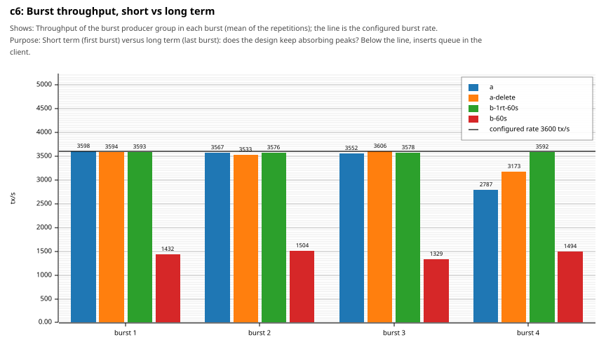
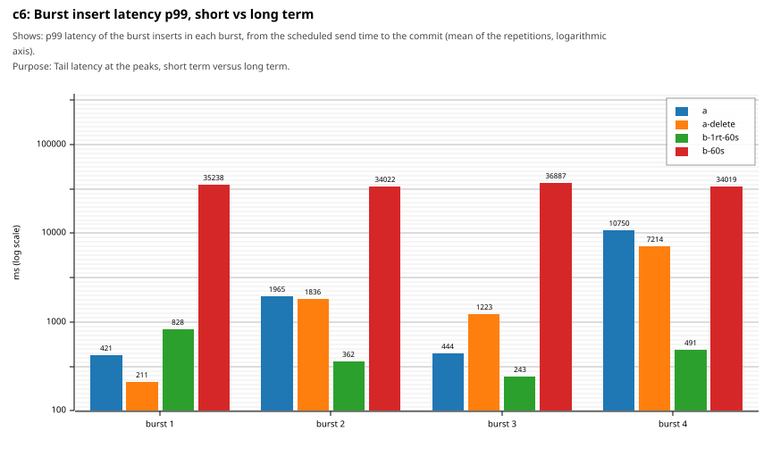
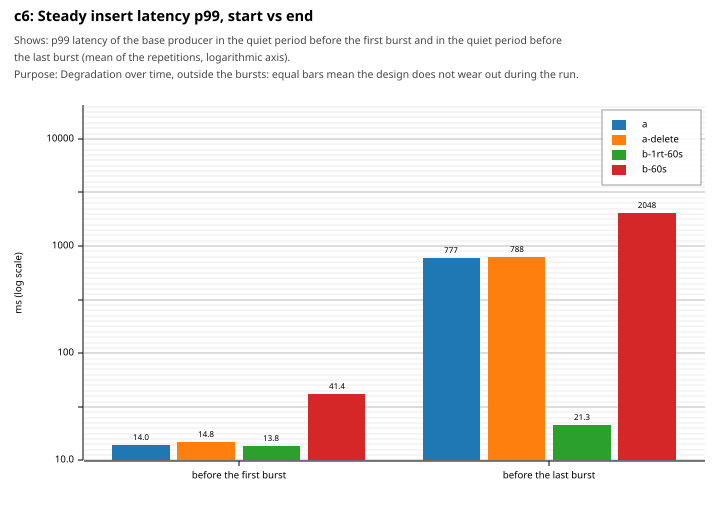
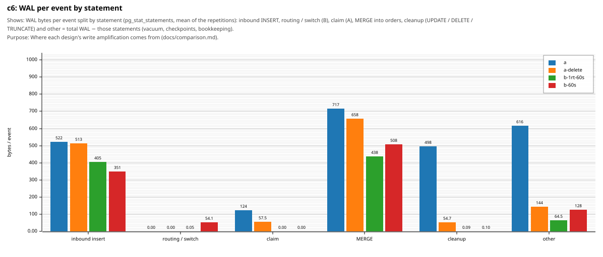
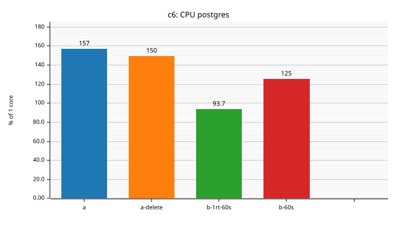

# A vs B — variants, facts and conclusions

Evidence: development VM (2 vCPU, 2 GB, CPU-bound), one repetition per run.
Main source: `results/burst60-20261127` (scenario c6, `summary.md` and
`bursts.md`); earlier facts from `results/smoke-20261127-0029` and
`results/campaign-20261126`. Confirm on a proper host before generalising.
What each campaign, scenario and label name means:
[`results/README.md`](../results/README.md).

**Requirement:** no insert may fail and no event may be lost, in either design.
Failure modes, what was measured and the conditions each design needs are in
[`insert-failures.md`](insert-failures.md).

## 1. Variants and nomenclature

All variants use the same event generator (pgbench, 4 phases per order), the
same `MERGE INTO orders` (forward-only state machine) and the same readers.

| Label | Project | Inbound table(s) | Producer, per event | Round trips | Consumer | Cleanup |
|---|---|---|---|---|---|---|
| `a` | A | `inbox`, PK + index `(state, id)` | autocommit `INSERT INTO inbox` | 1 | 4 competing workers: `SELECT … FOR UPDATE SKIP LOCKED` (≤ 500 rows) → `MERGE` → cleanup, one transaction per batch | `UPDATE state = 'F'` (rows kept) |
| `a-delete` | A | same | same | 1 | same | `DELETE` |
| `b` — **B 4RT** | B | `buffer_0` / `buffer_1`, no indexes; controller `buffer_control` (`LOCK_SLOTS` rows, default 64) | `BEGIN` · `SELECT active … FOR SHARE` · `INSERT INTO buffer_<active>` · `COMMIT` | 4 | 1 consumer: wait for data in hot → switch (`UPDATE buffer_control`, waits for in-flight inserts) → one `MERGE` of the whole cold buffer → `TRUNCATE` | `TRUNCATE` |
| `b-1rt` — **B 1RT** | B | same | one autocommit `INSERT INTO buffer_<last hot> … SELECT … FROM buffer_control WHERE slot = … AND active = <last hot> FOR SHARE`; 0 rows (a switch happened) → falls back to the 4RT path once | 1 (+1 transaction per client per switch) | same | same |

Suffixes and knobs:

| Suffix / label | Meaning |
|---|---|
| none | `MIN_CYCLE_MS=0`: the consumer switches as soon as the hot buffer has one row |
| `-30s`, `-60s` | `MIN_CYCLE_MS=30000` / `60000`: the hot buffer stays open at least that long (longer only if a drain takes longer) |
| `b-slots1`, `b-slots64` | `LOCK_SLOTS=1` (every producer shares one controller row) / 64 |

Terms: **RT** = round trip client → server → client; **hot** = buffer receiving
inserts; **cold** = buffer being drained; **cycle** = switch + drain;
**slot** = controller row a producer locks (`client % LOCK_SLOTS`).

## 2. Facts

### 2.1 Periodic bursts, 20 min (c6, `results/burst60-20261127`)

Load: 1,800 tx/s + 200 reads/s for 20 min; 4 bursts of 60 s at +3,600 tx/s
(t = 120, 420, 720, 1020 s). B variants with `MIN_CYCLE_MS=60000`.

| Metric | `a` | `a-delete` | `b-1rt-60s` | `b-60s` | Best |
|---|---:|---:|---:|---:|---|
| Events ingested | 2.96 M | 2.99 M | **3.02 M** | 2.50 M | B 1RT |
| Failed inserts / lost events | **0 / 0** | **0 / 0** | **0 / 0** | **0 / 0** | all |
| Producer p50 | 1.80 ms | 1.56 ms | **1.34 ms** | 4.63 ms | B 1RT |
| Producer p99, whole run | 1,212 ms | 918 ms | **60 ms** | 13.2 s | B 1RT |
| Steady p99, start | 14.0 ms | 14.8 ms | **13.8 ms** | 41.7 ms | A ≈ B 1RT |
| Steady p99, end | 777 ms | 789 ms | **21 ms** | 2,048 ms | B 1RT |
| Burst 1: tx/s (target 3,600) | **3,598** | 3,594 | 3,593 | 1,432 | A ≈ B 1RT |
| Burst 1: p99 | 421 ms | **211 ms** | 828 ms | 35 s | A-delete |
| Burst 4: tx/s | 2,787 | 3,173 | **3,592** | 1,494 | B 1RT |
| Burst 4: p99 | 10.7 s | 7.2 s | **492 ms** | 34 s | B 1RT |
| Burst 4: inserts over 2 s (client-timeout risk) | 63 % | 49 % | **0 %** | 96 % | B 1RT |
| Reader p99 (`orders`) | 1,028 ms | 214 ms | **20 ms** | 666 ms | B 1RT |
| End-to-end lag p95, typical | **0.01 s** | **0.01 s** | 63 s | 71 s | A |
| End-to-end lag p95, max | 32 s | **22 s** | 72 s | 102 s | A-delete |
| Drain after load | 0.4 s | **0.3 s** | 52 s | 53 s | A |
| Inbound size max / end | 1,570 / 1,570 MB | 150 / 36 MB | 118 / **0 MB** | 92 / 0 MB | B |
| Inbound dead tuples max | 624k | 353k | **0** | **0** | B |
| Autovacuum time | 255 s | 154 s | **20 s** | 60 s | B 1RT |
| WAL per event | 2,476 B | 1,427 B | **908 B** | 1,041 B | B 1RT |
| CPU postgres (% of 1 core) | 156 | 148 | **93** | 124 | B 1RT |

Score: no variant failed an insert or lost an event. Of the other 18 metrics,
B 1RT wins 14; A wins on freshness (lag, drain) and on the p99 of the first burst.

### 2.2 Where the cost goes (c6, WAL per event by statement)

| Step | `a` | `a-delete` | `b-1rt-60s` | `b-60s` |
|---|---:|---:|---:|---:|
| Inbound `INSERT` (A: heap + 2 indexes; B: heap only) | 522 B | 513 B | 405 B (lock included) | 351 B |
| Routing `SELECT … FOR SHARE` | – | – | – | 54 B |
| Claim `SELECT … FOR UPDATE SKIP LOCKED` | 124 B | 58 B | – | – |
| `MERGE INTO orders` | 717 B | 658 B | 438 B | 508 B |
| Cleanup (`UPDATE` / `DELETE` / `TRUNCATE`) | 498 B | 55 B | ≈ 0 | ≈ 0 |
| **Total incl. vacuum and full-page writes** | **2,476 B** | **1,427 B** | **908 B** | **1,041 B** |

Other measured facts:

- **Coalescing.** With 60 s cycles, an order often receives a later phase in the
  same cycle; one `MERGE` applies only the latest one. `b-1rt-60s` wrote 70 % of
  the events to `orders` (`b-60s` 81 %). A writes 100 %, because its batches
  of ≈ 20 rows rarely hold two phases of one order.
- **Cycle held.** All 21 cycles of each B run started 60.0–60.2 s apart. Drains
  took 4–20 s (1RT) and 9–46 s (4RT). The switch wait was p95 54 ms (1RT) and
  123 ms (4RT).
- **1RT re-routes, not failures.** 416 of 3.02 M inserts (0.014 %) met a
  switch and inserted 0 rows. The client saw the 0 and stored the event through
  the locked path in the same attempt. That is ≈ one per client per switch. With
  switches every ≈ 330 ms (C5 smoke, `MIN_CYCLE_MS=0`), 58 % re-routed.
- **CPU, quiet periods (whole VM).** `a` 189 %, `b-1rt-60s` 109 %, `b-60s` 175 %.
  The pgbench clients took 28 % for 1RT and 54 % for 4RT. With 4RT the VM
  saturated during bursts (1,329–1,504 of 3,600 tx/s), and its `MERGE` ran
  2–3× slower.
- **Consumer rate.** 288k rows in 15.4 s (≈ 18.7k rows/s) when CPU is spare
  (c6, 1RT). It falls to ≈ 3.3k rows/s when producers saturate the CPU
  (C1 `b`, campaign-20261126).

### 2.3 Earlier facts (smoke / dev campaign)

- **C1, 60 s saturation:** A 5,789 tps, `b` 2,958, `b-1rt` 6,167. The four round
  trips, not the lock, were B's ingestion cost.
- **`MIN_CYCLE_MS=0`, C2 at 1,800 tx/s:** 31 switches/s of ≈ 58 rows. The
  controller WAL alone was ≈ 150 B per event, enough to cancel B's WAL advantage.
- **C1 `b`, 5 min of saturation:** cycles grew on their own to 21–32 s.
  Throughput stayed at ≈ 3.1k tx/s, limited by routing.

### 2.4 Charts (c6)

Every chart prints under its title what it shows and what it is for. All
c6 charts, with their captions, are in `results/burst60-20261127/summary.md`.

## 3. Strengths and weaknesses

| Variant | Better at | Worse at |
|---|---|---|
| `a` | Freshness: an event reaches `orders` in milliseconds. Simplest design. Consumers scale out. | Degrades over time (steady p99 14 → 777 ms; burst 4 misses its target, 63 % of its inserts over 2 s). Table grows without bound. Highest WAL (2.7× B 1RT) and vacuum. Slow readers. |
| `a-delete` | Same freshness, best first-burst p99, smallest max lag. Bounded table. | Still degrades (p99 14 → 789 ms; burst 4: 49 % of inserts over 2 s). 353k dead tuples, 154 s of autovacuum. |
| `b-1rt-60s` | Flat latency over time. Absorbs every burst. ≈ 40 % less CPU, ≈ 1/3 of `a`'s WAL (64 % of `a-delete`'s), no inbound bloat or vacuum, fast readers, 30 % fewer `orders` writes. | Lag ≈ cycle + drain (≈ 60–70 s). Single consumer and one large `MERGE` per cycle. Only the last state per cycle reaches `orders`. More moving parts (controller, slots, fallback). Can lose events silently if a writer skips the protocol, so the database must enforce it ([insert failures](insert-failures.md#5-causes-specific-to-b)). |
| `b-60s` (4RT) | Same storage benefits as 1RT. | Routing costs 4 RT per event: CPU-bound, bursts at 40 % of target, p99 > 13 s (95 % of burst inserts over 2 s), worst lag. Worse than `b-1rt-60s` on every per-event metric. |
| `b` / `b-1rt` (no min. cycle) | Lowest B lag; self-clocking under saturation. | Dozens of switches per second at moderate load. Each switch costs a controller `UPDATE`, a `TRUNCATE`, a producer stall and, for 1RT, re-routes. |

## 4. Which one wins, and where

In a head-to-head on a real ingestion workload, **B 1RT with a long cycle
wins** whenever about one minute of delay is acceptable. It ingested more,
stayed flat for 20 min while A degraded, and used ≈ 40 % less Postgres CPU
and 37–64 % of A's WAL per event. **A wins** whenever an event must take effect within
seconds: B can never be faster than its cycle.

With **zero tolerance for failed inserts**, each design qualifies only under
conditions ([details](insert-failures.md#6-what-each-design-needs-for-zero-failures)):

- **A** needs CPU and vacuum headroom sized for the long term, because its
  tail latency grows with time.
- **B 1RT** needs the protocol enforced by the database (no direct `INSERT` on
  the buffers, the affected-row check) and a monitored consumer.
- **B 4RT** does not qualify under bursts.

| Scenario | Use | Why |
|---|---|---|
| Event must take effect in seconds (payments, user-visible status, notifications) | **A, `CLEANUP_MODE=delete`** | Lag in ms; B's floor is one cycle |
| High-volume ingestion, eventual consistency ≥ 1 min (telemetry, audit, sync, aggregation) | **B 1RT, long cycle** | Cheapest insert, no bloat or vacuum, flat latency |
| Recurring bursts far above the average | **B 1RT, long cycle** (A-delete with CPU headroom if lag matters) | The insert path is cheap; the drain is deferred to the next cycle |
| Many updates to the same entity in a short time | **B, long cycle** | Coalescing: fewer writes to the business table |
| Every transition must be applied individually, or consumers must scale out | **A** | B applies the last state per cycle with one consumer |
| Low volume, small team, simplicity first | **A-delete** | A's costs only matter at volume |
| Many clients behind a transaction pooler | **B 1RT** (never 4RT), `LOCK_SLOTS` ≥ server connections | 1RT holds a pooled connection for one round trip, like A (long cycles not measured in C5 yet) |

Avoid `b` (4RT): `b-1rt` matched or beat it in every run, except lag at
saturation, where it ingests faster than one consumer drains (C1 smoke). Avoid
`a` (update mode) without a purge job: the inbox only grows.

## 5. Conclusion

B's advantage is in storage, not in locking. It comes from four things:

- an insert-only heap without indexes;
- `TRUNCATE` instead of dead tuples and vacuum;
- one set-based `MERGE` per cycle;
- coalescing of events for the same order.

That advantage only appears when two conditions hold:

1. The producer routes in **one round trip** (`producer-1rt.sql`). With four
   round trips, routing costs more than the storage saves.
2. The cycle is **long** (tens of seconds). This makes the switch cost
   negligible and the 1RT re-routes rare.

With both, B is the better technique for volume and stability. A, preferably
with `DELETE`, stays the better technique for freshness, for scaling consumers
out and for simplicity.

**Rule of thumb:** if the tolerated delay is below the cycle you would need,
use A. If it is one minute or more and volume or bursts matter, use B 1RT
with a long cycle.

**Zero failures:** neither design failed or lost an insert (0 of 11.47 M in c6).
A is safer by construction, because the database enforces its invariant. Its
risk is late inserts as it degrades. B 1RT had no late insert, but it depends
on every writer following the protocol, so the database must enforce it.

Threats to validity:

- One repetition per run, on a 2-vCPU VM where every variant is CPU-bound.
- A keeps the PK and the `(state, id)` index, because its polling and cleanup
  need them.
- Producer latencies include pgbench schedule lag (`-R`).
- C5 (100k connections) with long cycles has not been measured.
