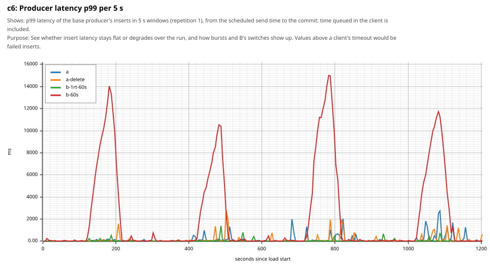
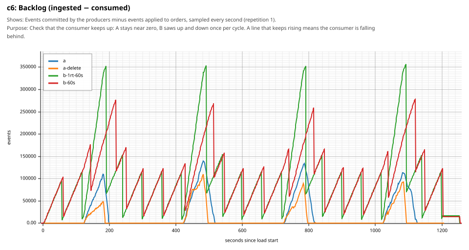
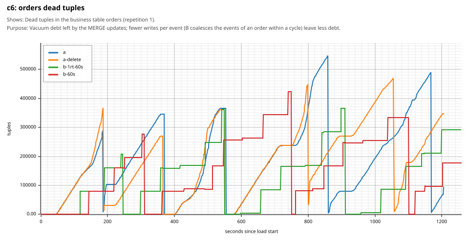
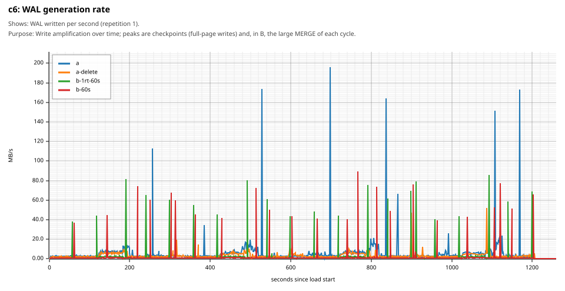
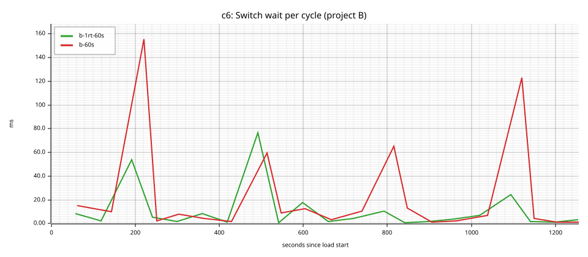
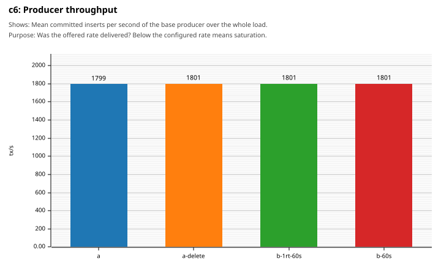
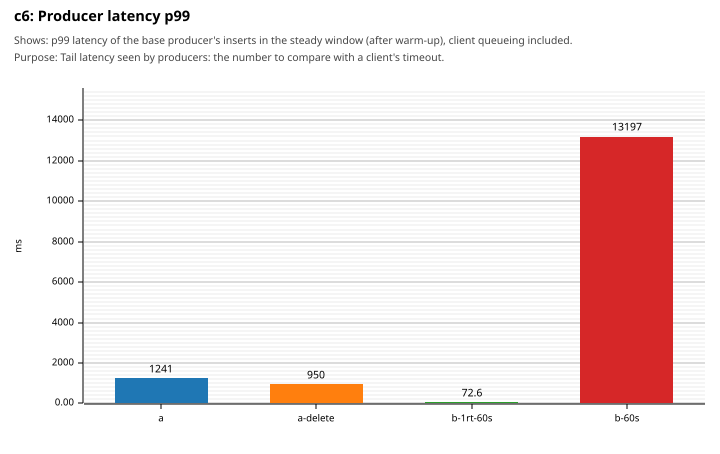

# Benchmark summary — campaign `burst60-20261127`

Generated by `common/tools/src/bin/report.rs` from the raw data of each run.
Cells: mean ± sample standard deviation across repetitions.
Latencies use the steady window (after WARMUP until the end of the load); counters (WAL, autovacuum, deadlocks) cover the load plus the final drain.

## c6

C6 — periodic bursts, long run: C2 load (2000 tx/s + readers) for 20 min and, every 5 min from t=120 s, a 60 s burst of a second producer group (16 clients, a new order id range per burst, distinct controller slots) adding 4000 tx/s (3× the base rate in total). The first burst shows the short term, the last one the long term (inbound table growth, vacuum, checkpoints). Labels: a, a-delete, b-60s (MIN_CYCLE_MS=60000), b-1rt-60s (producer-1rt.sql, MIN_CYCLE_MS=60000; the burst group uses the same producer script).

Runs — a: 1 rep., a-delete: 1 rep., b-1rt-60s: 1 rep., b-60s: 1 rep.

| Metric | a | a-delete | b-1rt-60s | b-60s |
|---|---:|---:|---:|---:|
| Producer throughput (tx/s) | 1799 | 1801 | 1801 | 1801 |
| Producer latency p50 (ms) | 1.87 | 1.60 | 1.35 | 5.00 |
| Producer latency p95 (ms) | 80.89 | 30.72 | 11.26 | 10608.64 |
| Producer latency p99 (ms) | 1241.09 | 949.76 | 72.58 | 13197.31 |
| Producer latency p99.9 (ms) | 2478.08 | 2283.52 | 772.61 | 14770.17 |
| Producer latency max (ms) | 2762.8 | 2865.2 | 1460.2 | 14991.4 |
| Burst producer throughput (tx/s) | 3376 | 3477 | 3585 | 1440 |
| Reader latency p50 (ms) | 0.95 | 0.76 | 0.54 | 0.71 |
| Reader latency p95 (ms) | 17.57 | 12.24 | 5.80 | 67.14 |
| Reader latency p99 (ms) | 1068.03 | 230.91 | 21.10 | 683.01 |
| End-to-end lag p50 (ms) | 977 | 44 | 44540 | 49149 |
| End-to-end lag p95 (ms) | 26560 | 17831 | 71740 | 102119 |
| End-to-end lag max (ms) | 32350 | 21864 | 79768 | 106597 |
| Backlog max (events) | 139590 | 110118 | 356523 | 277889 |
| Drain time after load (s) | 0.4 | 0.3 | 51.7 | 52.9 |
| Batches / cycles | 132828 | 182707 | 21 | 21 |
| Rows per batch / cycle | 22 | 16 | 143695 | 119080 |
| MERGE time per batch avg (ms) | 9.3 | 7.1 | 7314.6 | 18683.1 |
| Switch wait p50 (ms) | – | – | 3.9 | 8.2 |
| Switch wait p95 (ms) | – | – | 53.7 | 123.3 |
| Switch wait max (ms) | – | – | 76.4 | 155.8 |
| Consumer retries | 0 | 0 | 0 | 0 |
| Inbound table(s) size at end (MB) | 1497.6 | 34.6 | 0.0 | 0.0 |
| Inbound table(s) size max (MB) | 1497.6 | 143.0 | 112.5 | 87.5 |
| Inbound dead tuples max | 624077 | 353012 | 0 | 0 |
| orders size growth (MB) | 455.2 | 440.1 | 462.4 | 458.0 |
| orders dead tuples max | 546305 | 469948 | 365520 | 423057 |
| Autovacuum runs (all tables) | 21 | 34 | 56 | 56 |
| Autovacuum time (s, all tables) | 254.8 | 154.4 | 20.1 | 59.7 |
| WAL generated (MB) | 6997 | 4066 | 2614 | 2483 |
| WAL per event (bytes) | 2476 | 1427 | 908 | 1041 |
| Deadlocks | 0 | 0 | 0 | 0 |
| Rollbacks | 0 | 0 | 0 | 0 |
| MultiXact SLRU blocks zeroed | 128 | 171 | 0 | 0 |
| CPU postgres (% of 1 core) | 157 | 150 | 94 | 125 |
| CPU consumer (% of 1 core) | 9 | 12 | 0 | 0 |
| CPU pgbench (% of 1 core) | 25 | 25 | 28 | 54 |

Top wait events (avg active sessions, repetition 1):

- **a**: LWLock:WALWrite 5.23, CPU:running 2.07, IO:WalSync 0.63, LWLock:BufferContent 0.33, IO:DataFileRead 0.26
- **a-delete**: LWLock:WALWrite 4.77, CPU:running 1.74, IO:WalSync 0.64, LWLock:BufferContent 0.24, Client:ClientRead 0.23
- **b-1rt-60s**: LWLock:WALWrite 4.37, CPU:running 0.83, IO:WalSync 0.59, Client:ClientRead 0.20, LWLock:BufferContent 0.19
- **b-60s**: LWLock:WALWrite 4.36, CPU:running 1.58, IO:WalSync 0.60, LWLock:BufferContent 0.23, Client:ClientRead 0.15

Charts:

