# Benchmark summary — campaign `campaign-20261126`

Generated by `common/tools/src/bin/report.rs` from the raw data of each run.
Cells: mean ± sample standard deviation across repetitions.
Latencies use the steady window (after WARMUP until the end of the load); counters (WAL, autovacuum, deadlocks) cover the load plus the final drain.

## c1

C1 — maximum ingestion: 16 producers without rate limit, consumers active, no readers. Measures producer throughput and how far each consumer falls behind at saturation.

Runs — a: 3 rep., b: 3 rep.

| Metric | a | b |
|---|---:|---:|
| Producer throughput (tx/s) | 5286 ± 23 | 3088 ± 43 |
| Producer latency p50 (ms) | 2.12 ± 0.03 | 4.45 ± 0.05 |
| Producer latency p95 (ms) | 7.55 ± 0.09 | 10.35 ± 0.37 |
| Producer latency p99 (ms) | 16.27 ± 0.60 | 20.30 ± 0.73 |
| Producer latency p99.9 (ms) | 82.73 ± 3.44 | 43.67 ± 1.67 |
| Producer latency max (ms) | 1062.4 ± 366.5 | 114.2 ± 7.7 |
| End-to-end lag p50 (ms) | 47403 ± 3707 | 28500 ± 17231 |
| End-to-end lag p95 (ms) | 70499 ± 1477 | 49623 ± 11512 |
| End-to-end lag max (ms) | 72947 ± 1282 | 50957 ± 11841 |
| Backlog max (events) | 348662 ± 5970 | 157122 ± 37593 |
| Drain time after load (s) | 36.1 ± 1.9 | 2.4 ± 2.0 |
| Batches / cycles | 3184 ± 14 | 70 ± 44 |
| Rows per batch / cycle | 498 ± 0 | 17647 ± 11484 |
| MERGE time per batch avg (ms) | 180.2 ± 0.6 | 5459.1 ± 3554.1 |
| Switch wait p50 (ms) | – | 25.1 ± 1.7 |
| Switch wait p95 (ms) | – | 46.3 ± 4.1 |
| Switch wait max (ms) | – | 69.0 ± 22.8 |
| Consumer retries | 0 ± 0 | 0 ± 0 |
| Inbound table(s) size at end (MB) | 989.4 ± 17.4 | 0.0 ± 0.0 |
| Inbound table(s) size max (MB) | 989.4 ± 17.4 | 49.8 ± 11.8 |
| Inbound dead tuples max | 755074 ± 23708 | 0 ± 0 |
| orders size growth (MB) | 316.9 ± 1.4 | 229.0 ± 14.8 |
| orders dead tuples max | 459286 ± 1176 | 383818 ± 29286 |
| Autovacuum runs (all tables) | 7 ± 0 | 16 ± 1 |
| Autovacuum time (s, all tables) | 126.8 ± 3.0 | 10.0 ± 5.5 |
| WAL generated (MB) | 3582 ± 13 | 929 ± 13 |
| WAL per event (bytes) | 2370 ± 7 | 1052 ± 5 |
| Deadlocks | 0 ± 0 | 0 ± 0 |
| Rollbacks | 0 ± 0 | 0 ± 0 |
| MultiXact SLRU blocks zeroed | 6 ± 0 | 0 ± 0 |
| CPU postgres (% of 1 core) | 163 ± 1 | 150 ± 1 |
| CPU consumer (% of 1 core) | 1 ± 0 | 0 ± 0 |
| CPU pgbench (% of 1 core) | 31 ± 0 | 60 ± 1 |

Top wait events (avg active sessions, repetition 1):

- **a**: LWLock:WALWrite 11.24, CPU:running 3.82, IO:WalSync 0.75, LWLock:WALInsert 0.58, LWLock:BufferContent 0.56
- **b**: LWLock:WALWrite 5.04, CPU:running 2.24, IO:WalSync 0.68, LWLock:BufferContent 0.26, LWLock:WALInsert 0.14

Charts:

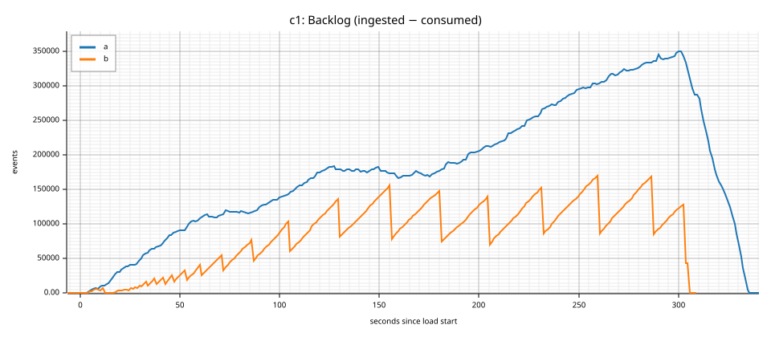

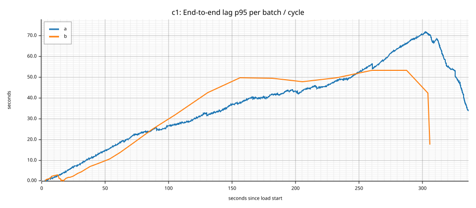

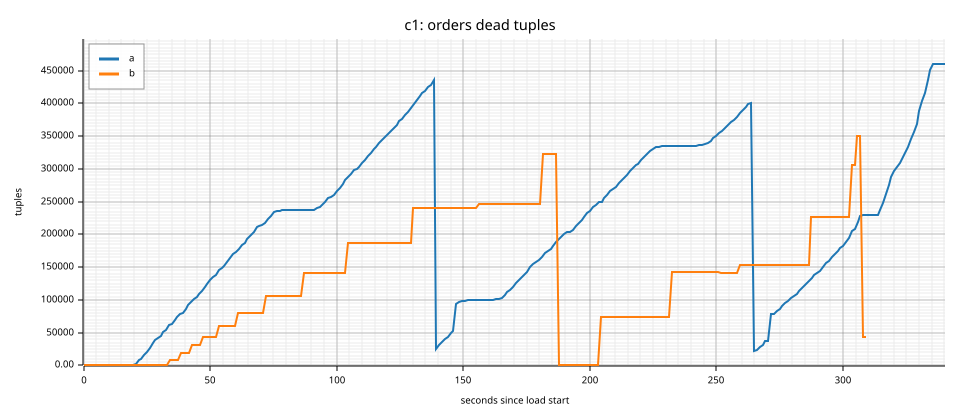

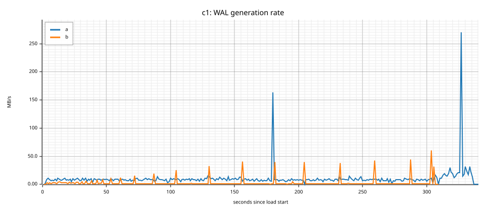

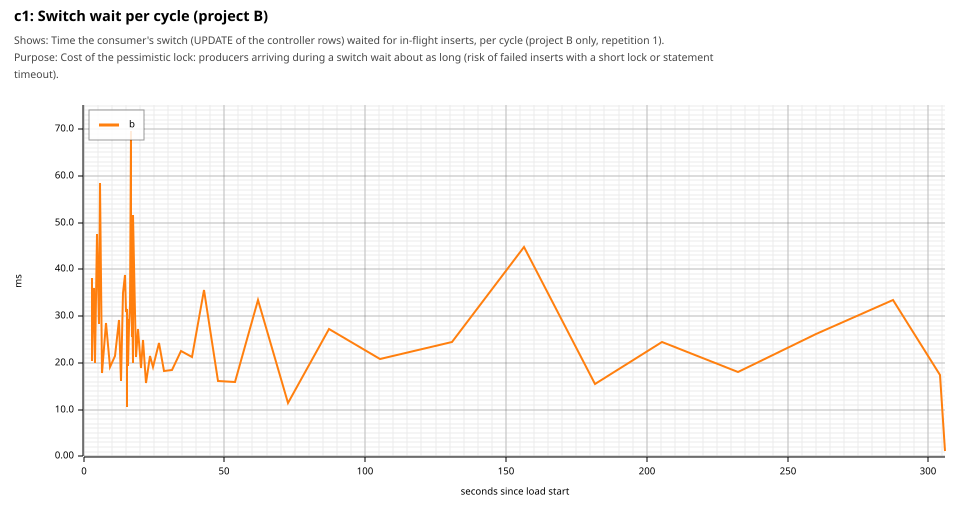

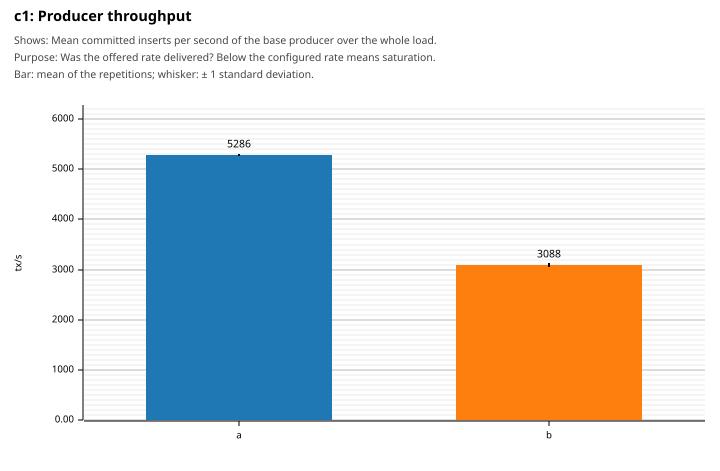

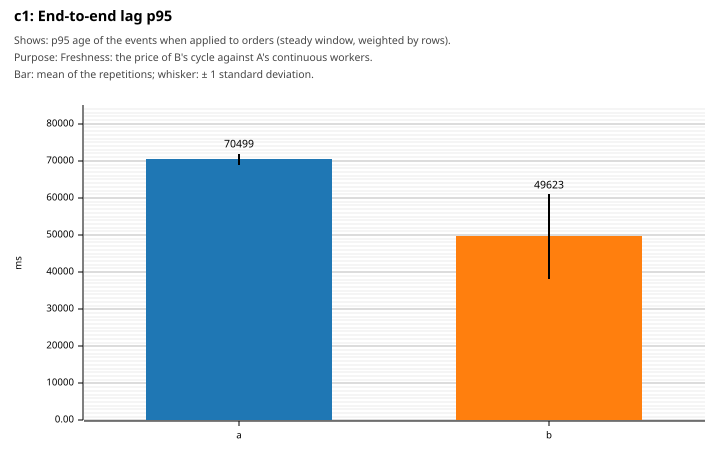

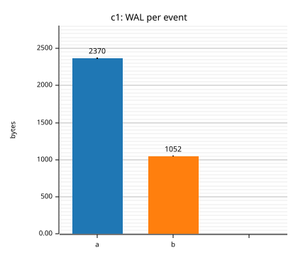

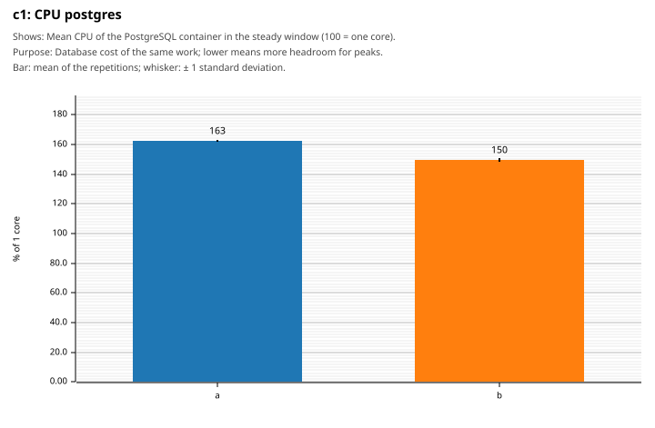

## c2

C2 — sustained load: 16 producers at 2000 tx/s in total (≈64% of B's and ≈34% of A's saturation throughput in the pilot) plus business readers at 200 tx/s on orders. Labels: a (CLEANUP_MODE=update), a-delete (CLEANUP_MODE=delete), b (LOCK_SLOTS=64, one controller row per producer), b-slots1 (C4: LOCK_SLOTS=1, every producer shares one controller row).

Runs — a: 1 rep., a-delete: 1 rep., b: 1 rep.

| Metric | a | a-delete | b |
|---|---:|---:|---:|
| Producer throughput (tx/s) | 1998 | 2001 | 2000 |
| Producer latency p50 (ms) | 1.31 | 1.19 | 3.01 |
| Producer latency p95 (ms) | 17.74 | 6.57 | 34.53 |
| Producer latency p99 (ms) | 1028.10 | 20.73 | 159.49 |
| Producer latency p99.9 (ms) | 2134.01 | 216.06 | 393.47 |
| Producer latency max (ms) | 2377.7 | 374.3 | 517.9 |
| Reader latency p50 (ms) | 0.69 | 0.56 | 0.60 |
| Reader latency p95 (ms) | 7.05 | 3.83 | 5.55 |
| Reader latency p99 (ms) | 278.01 | 10.29 | 14.36 |
| End-to-end lag p50 (ms) | 11 | 9 | 55 |
| End-to-end lag p95 (ms) | 90 | 35 | 316 |
| End-to-end lag max (ms) | 1120 | 332 | 1181 |
| Backlog max (events) | 5 | 0 | 586 |
| Drain time after load (s) | 0.3 | 0.3 | 0.3 |
| Batches / cycles | 114838 | 137211 | 12488 |
| Rows per batch / cycle | 10 | 9 | 96 |
| MERGE time per batch avg (ms) | 4.0 | 3.4 | 19.4 |
| Switch wait p50 (ms) | – | – | 3.8 |
| Switch wait p95 (ms) | – | – | 24.1 |
| Switch wait max (ms) | – | – | 338.8 |
| Consumer retries | 0 | 0 | 0 |
| Inbound table(s) size at end (MB) | 588.9 | 18.2 | 0.0 |
| Inbound table(s) size max (MB) | 588.9 | 19.4 | 3.1 |
| Inbound dead tuples max | 247181 | 130470 | 0 |
| orders size growth (MB) | 168.3 | 160.6 | 163.8 |
| orders dead tuples max | 292081 | 282760 | 281606 |
| Autovacuum runs (all tables) | 17 | 20 | 20 |
| Autovacuum time (s, all tables) | 38.6 | 18.4 | 11.0 |
| WAL generated (MB) | 2050 | 1565 | 1575 |
| WAL per event (bytes) | 1794 | 1367 | 1376 |
| Deadlocks | 0 | 0 | 0 |
| Rollbacks | 0 | 0 | 0 |
| MultiXact SLRU blocks zeroed | 126 | 138 | 0 |
| CPU postgres (% of 1 core) | 147 | 145 | 139 |
| CPU consumer (% of 1 core) | 15 | 18 | 2 |
| CPU pgbench (% of 1 core) | 21 | 22 | 51 |

Top wait events (avg active sessions, repetition 1):

- **a**: LWLock:WALWrite 2.81, CPU:running 1.41, IO:WalSync 0.61, Client:ClientRead 0.21, IO:DataFileRead 0.12
- **a-delete**: LWLock:WALWrite 1.99, CPU:running 1.25, IO:WalSync 0.58, Client:ClientRead 0.23, LWLock:BufferContent 0.05
- **b**: LWLock:WALWrite 2.76, CPU:running 1.37, IO:WalSync 0.58, Lock:transactionid 0.43, Client:ClientRead 0.17

Charts:

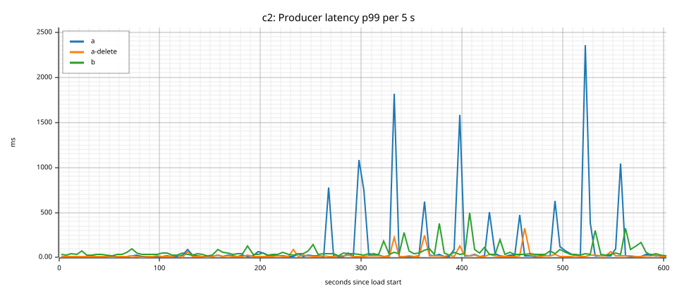

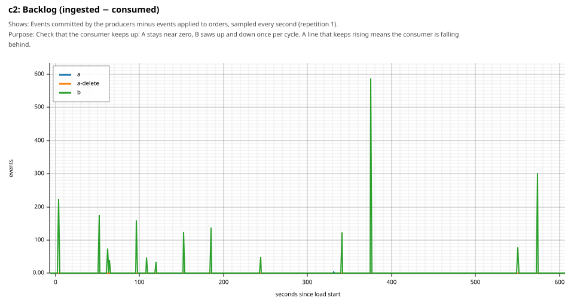

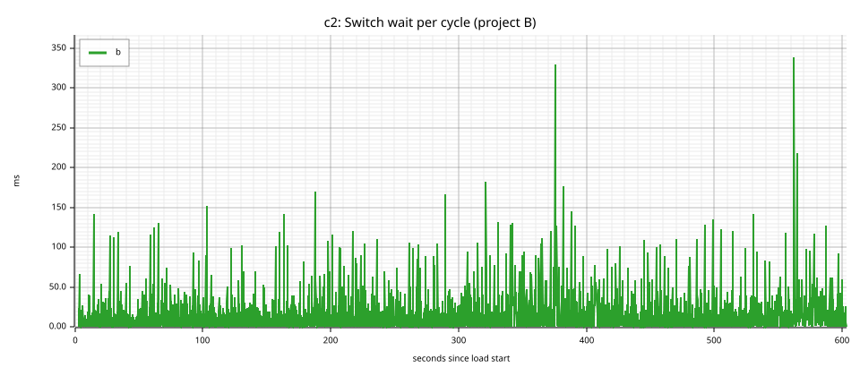

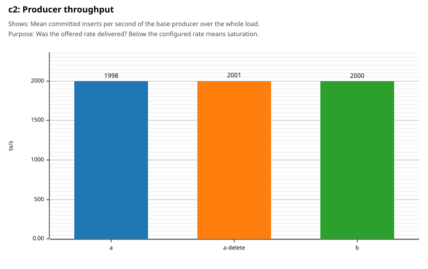

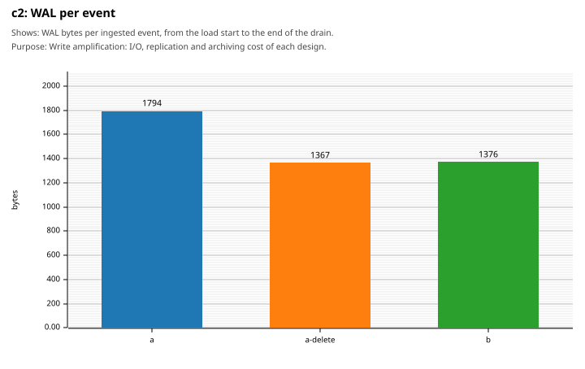

