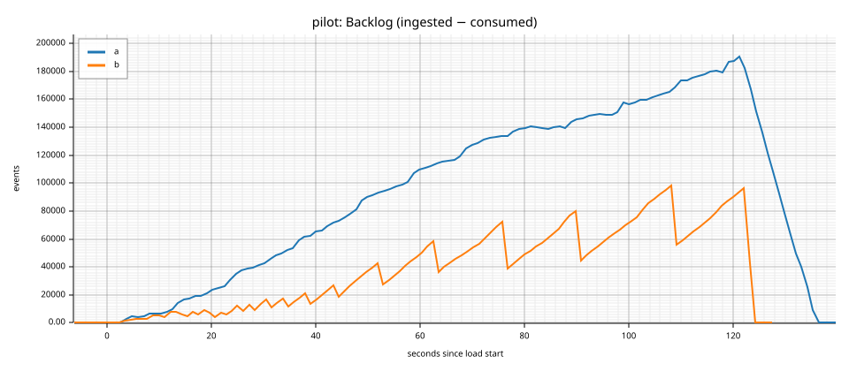
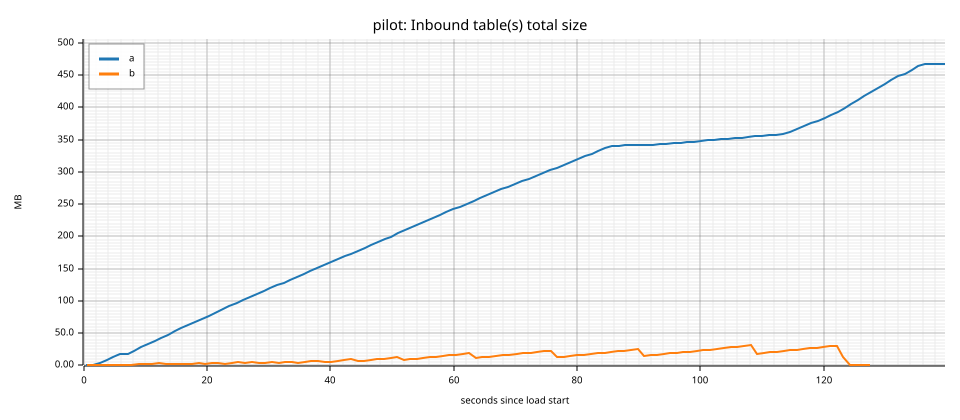
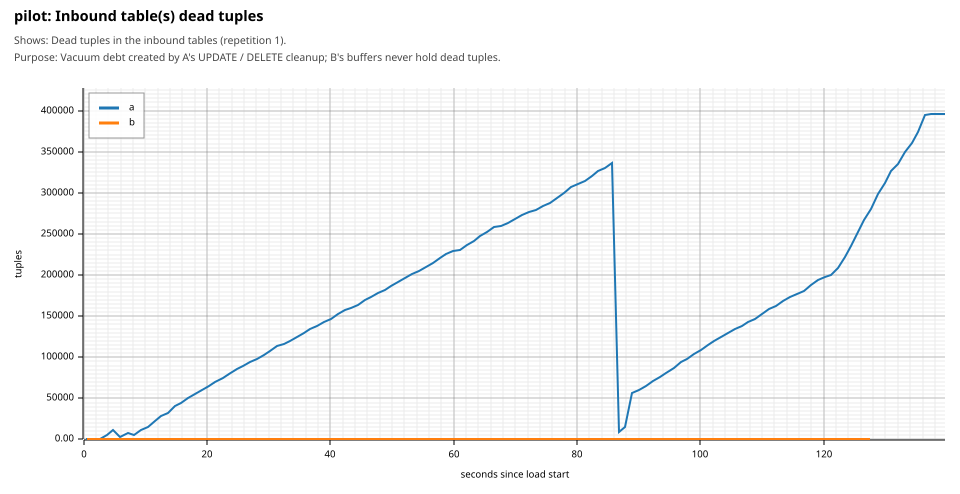
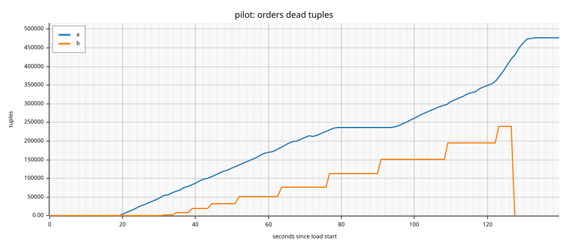
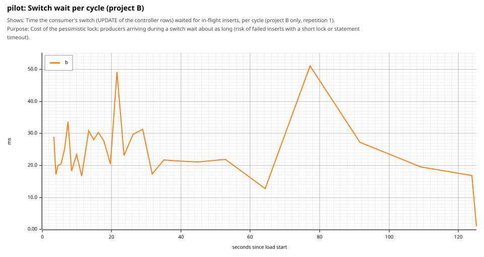
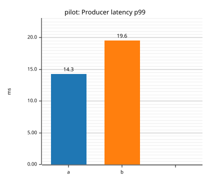
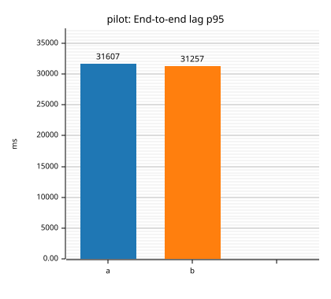
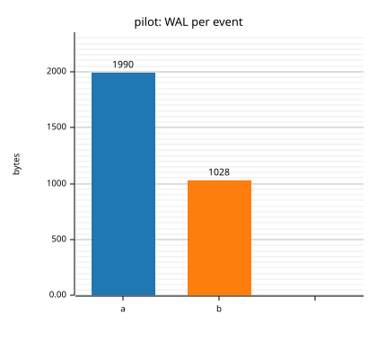
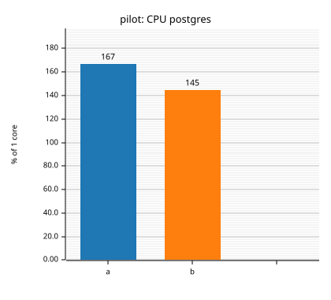
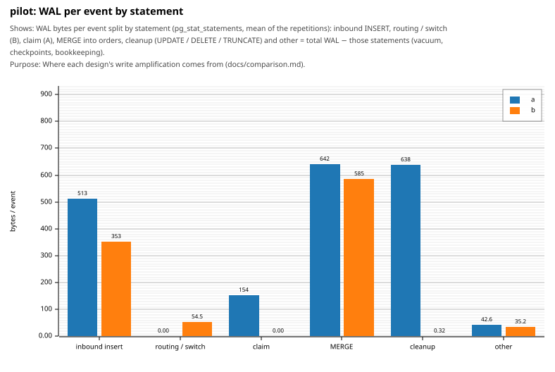

# Benchmark summary — campaign `pilot`

Generated by `common/tools/src/bin/report.rs` from the raw data of each run.
Cells: mean ± sample standard deviation across repetitions.
Latencies use the steady window (after WARMUP until the end of the load); counters (WAL, autovacuum, deadlocks) cover the load plus the final drain.

## pilot

Runs — a: 1 rep., b: 1 rep.

| Metric | a | b |
|---|---:|---:|
| Producer throughput (tx/s) | 5940 | 3121 |
| Producer latency p50 (ms) | 1.96 | 4.47 |
| Producer latency p95 (ms) | 6.70 | 10.24 |
| Producer latency p99 (ms) | 14.28 | 19.55 |
| Producer latency p99.9 (ms) | 58.53 | 39.84 |
| Producer latency max (ms) | 167.2 | 66.0 |
| End-to-end lag p50 (ms) | 23921 | 18637 |
| End-to-end lag p95 (ms) | 31607 | 31257 |
| End-to-end lag max (ms) | 32562 | 32103 |
| Backlog max (events) | 190683 | 98168 |
| Drain time after load (s) | 14.0 | 1.6 |
| Batches / cycles | 1432 | 30 |
| Rows per batch / cycle | 497 | 12471 |
| MERGE time per batch avg (ms) | 175.1 | 3835.1 |
| Switch wait p50 (ms) | – | 22.3 |
| Switch wait p95 (ms) | – | 49.2 |
| Switch wait max (ms) | – | 51.0 |
| Consumer retries | 0 | 0 |
| Inbound table(s) size at end (MB) | 467.7 | 0.0 |
| Inbound table(s) size max (MB) | 467.7 | 31.2 |
| Inbound dead tuples max | 395320 | 0 |
| orders size growth (MB) | 245.9 | 139.2 |
| orders dead tuples max | 477424 | 239459 |
| Autovacuum runs (all tables) | 2 | 5 |
| Autovacuum time (s, all tables) | 14.1 | 1.9 |
| WAL generated (MB) | 1351 | 367 |
| WAL per event (bytes) | 1990 | 1028 |
| Deadlocks | 0 | 0 |
| Rollbacks | 0 | 0 |
| MultiXact SLRU blocks zeroed | 3 | 0 |
| CPU postgres (% of 1 core) | 167 | 145 |
| CPU consumer (% of 1 core) | 1 | 0 |
| CPU pgbench (% of 1 core) | 35 | 59 |

Top wait events (avg active sessions, repetition 1):

- **a**: LWLock:WALWrite 11.15, CPU:running 4.00, IO:WalSync 0.76, LWLock:BufferContent 0.58, LWLock:WALInsert 0.57
- **b**: LWLock:WALWrite 5.11, CPU:running 2.02, IO:WalSync 0.72, LWLock:BufferContent 0.25, LWLock:WALInsert 0.11

Charts (each one states under its title what it shows and what it is for):

*Shows:* p99 latency of the base producer's inserts in 5 s windows (repetition 1), from the scheduled send time to the commit: time queued in the client is included. *Purpose:* See whether insert latency stays flat or degrades over the run, and how bursts and B's switches show up. Values above a client's timeout would be failed inserts.

*Shows:* Events committed by the producers minus events applied to orders, sampled every second (repetition 1). *Purpose:* Check that the consumer keeps up: A stays near zero, B saws up and down once per cycle. A line that keeps rising means the consumer is falling behind.

*Shows:* p95 age of the events (commit → applied to orders) of each batch (A) or cycle (B), at the time the batch finished (repetition 1). *Purpose:* Freshness of orders over time. B's floor is one cycle; peaks in A are bursts the workers could not absorb at once.

*Shows:* Total size (heap + indexes + TOAST) of the inbound tables: inbox in A, buffer_0 + buffer_1 in B (repetition 1). *Purpose:* Growth and bloat on the ingestion side: A's inbox keeps growing in update mode, B returns to zero at every TRUNCATE.

*Shows:* Dead tuples in the inbound tables (repetition 1). *Purpose:* Vacuum debt created by A's UPDATE / DELETE cleanup; B's buffers never hold dead tuples.

*Shows:* Dead tuples in the business table orders (repetition 1). *Purpose:* Vacuum debt left by the MERGE updates; fewer writes per event (B coalesces the events of an order within a cycle) leave less debt.

*Shows:* WAL written per second (repetition 1). *Purpose:* Write amplification over time; peaks are checkpoints (full-page writes) and, in B, the large MERGE of each cycle.

*Shows:* Time the consumer's switch (UPDATE of the controller rows) waited for in-flight inserts, per cycle (project B only, repetition 1). *Purpose:* Cost of the pessimistic lock: producers arriving during a switch wait about as long (risk of failed inserts with a short lock or statement timeout).

*Shows:* Mean committed inserts per second of the base producer over the whole load. *Purpose:* Was the offered rate delivered? Below the configured rate means saturation.

*Shows:* p99 latency of the base producer's inserts in the steady window (after warm-up), client queueing included. *Purpose:* Tail latency seen by producers: the number to compare with a client's timeout.

*Shows:* p95 age of the events when applied to orders (steady window, weighted by rows). *Purpose:* Freshness: the price of B's cycle against A's continuous workers.

*Shows:* WAL bytes per ingested event, from the load start to the end of the drain. *Purpose:* Write amplification: I/O, replication and archiving cost of each design.

*Shows:* Mean CPU of the PostgreSQL container in the steady window (100 = one core). *Purpose:* Database cost of the same work; lower means more headroom for peaks.

*Shows:* WAL bytes per event split by statement (pg_stat_statements, mean of the repetitions): inbound INSERT, routing / switch (B), claim (A), MERGE into orders, cleanup (UPDATE / DELETE / TRUNCATE) and other = total WAL − those statements (vacuum, checkpoints, bookkeeping). *Purpose:* Where each design's write amplification comes from (docs/comparison.md).

