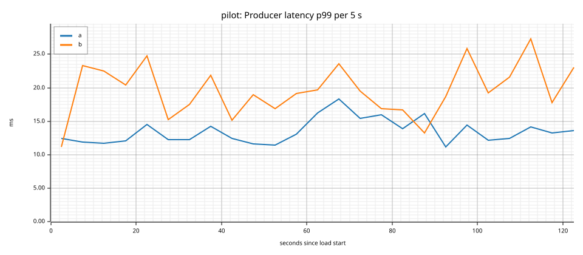
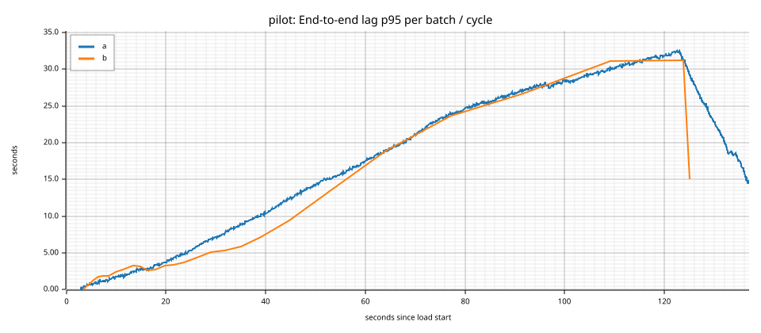
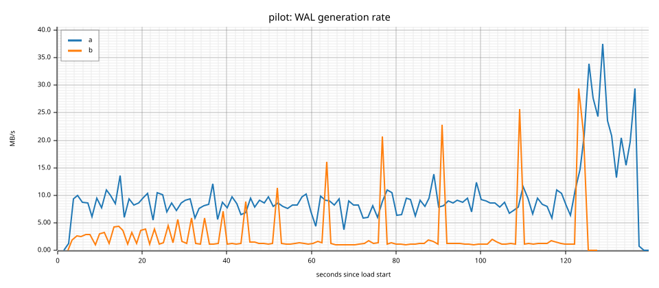
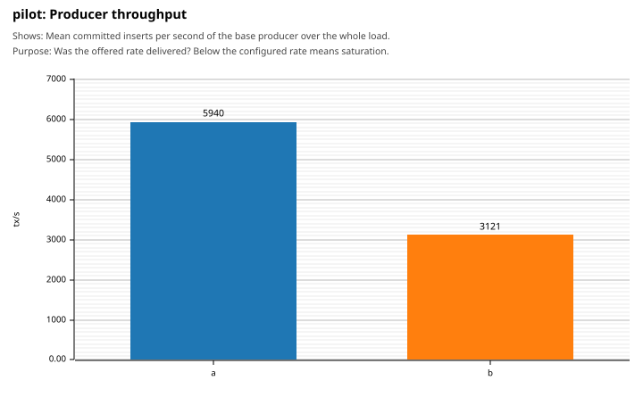

# Benchmark summary — campaign `pilot`

Generated by `common/tools/src/bin/report.rs` from the raw data of each run.
Cells: mean ± sample standard deviation across repetitions.
Latencies use the steady window (after WARMUP until the end of the load); counters (WAL, autovacuum, deadlocks) cover the load plus the final drain.

## pilot

Runs — a: 1 rep., b: 1 rep.

| Metric | a | b |
|---|---:|---:|
| Producer throughput (tx/s) | 5940 | 3121 |
| Producer latency p50 (ms) | 1.96 | 4.47 |
| Producer latency p95 (ms) | 6.70 | 10.24 |
| Producer latency p99 (ms) | 14.28 | 19.55 |
| Producer latency p99.9 (ms) | 58.53 | 39.84 |
| Producer latency max (ms) | 167.2 | 66.0 |
| End-to-end lag p50 (ms) | 23921 | 18637 |
| End-to-end lag p95 (ms) | 31607 | 31257 |
| End-to-end lag max (ms) | 32562 | 32103 |
| Backlog max (events) | 190683 | 98168 |
| Drain time after load (s) | 14.0 | 1.6 |
| Batches / cycles | 1432 | 30 |
| Rows per batch / cycle | 497 | 12471 |
| MERGE time per batch avg (ms) | 175.1 | 3835.1 |
| Switch wait p50 (ms) | – | 22.3 |
| Switch wait p95 (ms) | – | 49.2 |
| Switch wait max (ms) | – | 51.0 |
| Consumer retries | 0 | 0 |
| Inbound table(s) size at end (MB) | 467.7 | 0.0 |
| Inbound table(s) size max (MB) | 467.7 | 31.2 |
| Inbound dead tuples max | 395320 | 0 |
| orders size growth (MB) | 245.9 | 139.2 |
| orders dead tuples max | 477424 | 239459 |
| Autovacuum runs (all tables) | 2 | 5 |
| Autovacuum time (s, all tables) | 14.1 | 1.9 |
| WAL generated (MB) | 1351 | 367 |
| WAL per event (bytes) | 1990 | 1028 |
| Deadlocks | 0 | 0 |
| Rollbacks | 0 | 0 |
| MultiXact SLRU blocks zeroed | 3 | 0 |
| CPU postgres (% of 1 core) | 167 | 145 |
| CPU consumer (% of 1 core) | 1 | 0 |
| CPU pgbench (% of 1 core) | 35 | 59 |

Top wait events (avg active sessions, repetition 1):

- **a**: LWLock:WALWrite 11.15, CPU:running 4.00, IO:WalSync 0.76, LWLock:BufferContent 0.58, LWLock:WALInsert 0.57
- **b**: LWLock:WALWrite 5.11, CPU:running 2.02, IO:WalSync 0.72, LWLock:BufferContent 0.25, LWLock:WALInsert 0.11

Charts:

