# Benchmark summary — campaign `smoke-20261127-0029`

Generated by `common/tools/src/bin/report.rs` from the raw data of each run.
Cells: mean ± sample standard deviation across repetitions.
Latencies use the steady window (after WARMUP until the end of the load); counters (WAL, autovacuum, deadlocks) cover the load plus the final drain.

## c1

C1 — maximum ingestion: 16 producers without rate limit, consumers active, no readers. Measures producer throughput and how far each consumer falls behind at saturation. Labels: a, b, b-1rt (B with the single-round-trip producer, producer-1rt.sql).

Runs — a: 1 rep., b: 1 rep., b-1rt: 1 rep.

| Metric | a | b | b-1rt |
|---|---:|---:|---:|
| Producer throughput (tx/s) | 5789 | 2958 | 6167 |
| Producer latency p50 (ms) | 1.92 | 4.35 | 2.05 |
| Producer latency p95 (ms) | 7.31 | 11.73 | 5.63 |
| Producer latency p99 (ms) | 14.89 | 22.83 | 13.11 |
| Producer latency p99.9 (ms) | 43.17 | 49.63 | 38.56 |
| Producer latency max (ms) | 89.7 | 82.2 | 102.0 |
| End-to-end lag p50 (ms) | 7197 | 1018 | 6040 |
| End-to-end lag p95 (ms) | 11303 | 3932 | 12417 |
| End-to-end lag max (ms) | 11899 | 4718 | 12788 |
| Backlog max (events) | 66208 | 13270 | 74814 |
| Drain time after load (s) | 3.9 | 0.2 | 1.6 |
| Batches / cycles | 701 | 103 | 32 |
| Rows per batch / cycle | 494 | 1719 | 11534 |
| MERGE time per batch avg (ms) | 164.2 | 477.5 | 1776.7 |
| Switch wait p50 (ms) | – | 27.1 | 57.3 |
| Switch wait p95 (ms) | – | 73.2 | 91.9 |
| Switch wait max (ms) | – | 101.6 | 93.9 |
| Consumer retries | 0 | 0 | 0 |
| Inbound table(s) size at end (MB) | 234.1 | 0.0 | 0.0 |
| Inbound table(s) size max (MB) | 234.1 | 4.5 | 24.2 |
| Inbound dead tuples max | 196470 | 0 | 0 |
| orders size growth (MB) | 105.8 | 64.1 | 109.3 |
| orders dead tuples max | 188648 | 94432 | 159155 |
| Autovacuum runs (all tables) | 2 | 2 | 4 |
| Autovacuum time (s, all tables) | 3.0 | 0.5 | 1.3 |
| WAL generated (MB) | 610 | 176 | 363 |
| WAL per event (bytes) | 1847 | 1039 | 1032 |
| Deadlocks | 0 | 0 | 0 |
| Rollbacks | 0 | 0 | 0 |
| MultiXact SLRU blocks zeroed | 2 | 0 | 0 |
| CPU postgres (% of 1 core) | 172 | 142 | 164 |
| CPU consumer (% of 1 core) | 1 | 0 | 0 |
| CPU pgbench (% of 1 core) | 34 | 56 | 38 |

Top wait events (avg active sessions, repetition 1):

- **a**: LWLock:WALWrite 10.82, CPU:running 4.05, IO:WalSync 0.72, LWLock:WALInsert 0.62, LWLock:BufferContent 0.58
- **b**: LWLock:WALWrite 5.03, CPU:running 2.03, IO:WalSync 0.67, Lock:transactionid 0.45, LWLock:BufferContent 0.16
- **b-1rt**: LWLock:WALWrite 11.31, CPU:running 2.01, IO:WalSync 0.78, LWLock:BufferContent 0.25, LWLock:WALInsert 0.13

Charts (each one states under its title what it shows and what it is for):

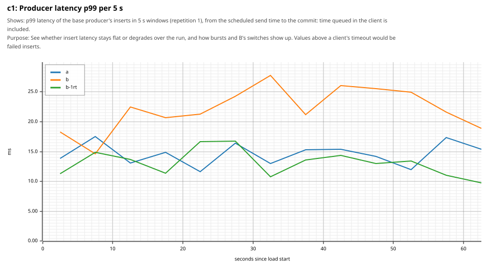

*Shows:* p99 latency of the base producer's inserts in 5 s windows (repetition 1), from the scheduled send time to the commit: time queued in the client is included. *Purpose:* See whether insert latency stays flat or degrades over the run, and how bursts and B's switches show up. Values above a client's timeout would be failed inserts.

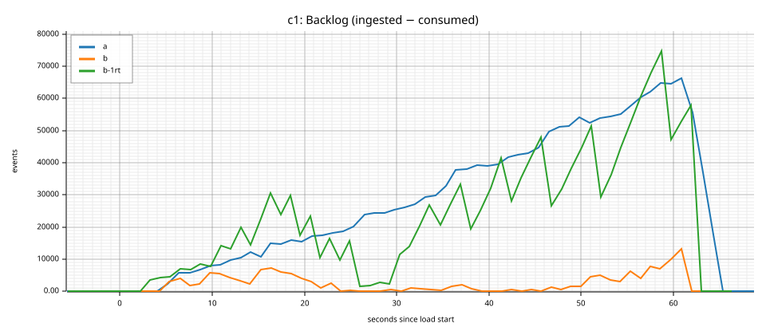

*Shows:* Events committed by the producers minus events applied to orders, sampled every second (repetition 1). *Purpose:* Check that the consumer keeps up: A stays near zero, B saws up and down once per cycle. A line that keeps rising means the consumer is falling behind.

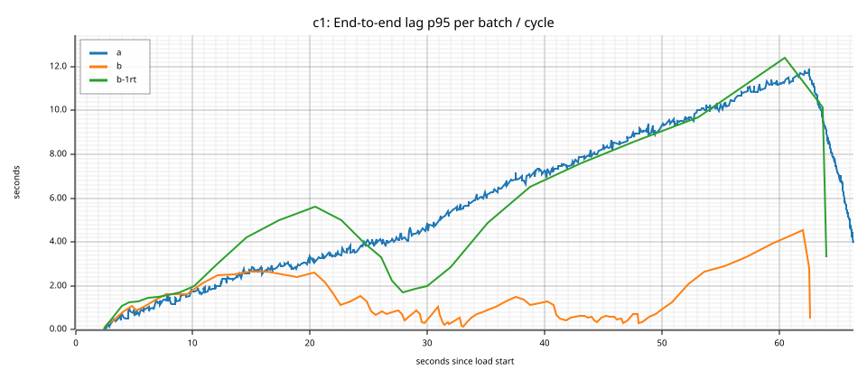

*Shows:* p95 age of the events (commit → applied to orders) of each batch (A) or cycle (B), at the time the batch finished (repetition 1). *Purpose:* Freshness of orders over time. B's floor is one cycle; peaks in A are bursts the workers could not absorb at once.

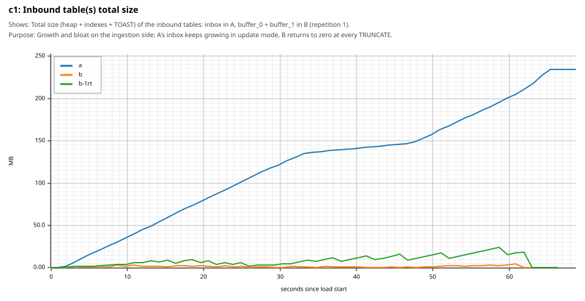

*Shows:* Total size (heap + indexes + TOAST) of the inbound tables: inbox in A, buffer_0 + buffer_1 in B (repetition 1). *Purpose:* Growth and bloat on the ingestion side: A's inbox keeps growing in update mode, B returns to zero at every TRUNCATE.

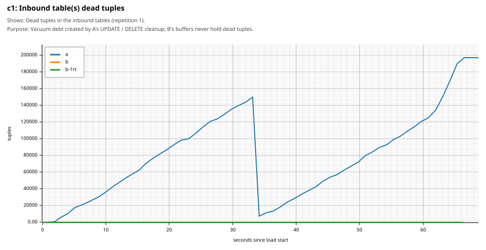

*Shows:* Dead tuples in the inbound tables (repetition 1). *Purpose:* Vacuum debt created by A's UPDATE / DELETE cleanup; B's buffers never hold dead tuples.

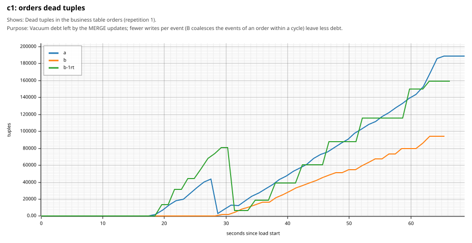

*Shows:* Dead tuples in the business table orders (repetition 1). *Purpose:* Vacuum debt left by the MERGE updates; fewer writes per event (B coalesces the events of an order within a cycle) leave less debt.

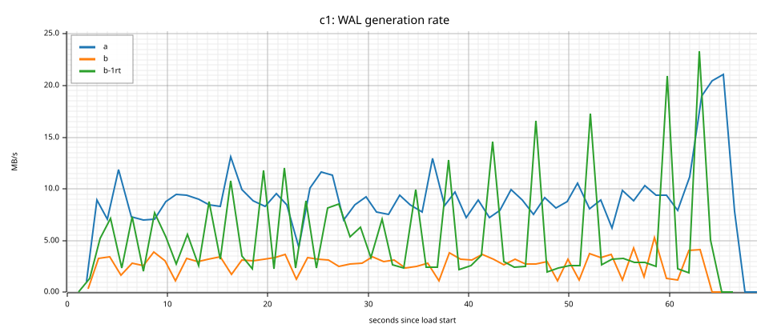

*Shows:* WAL written per second (repetition 1). *Purpose:* Write amplification over time; peaks are checkpoints (full-page writes) and, in B, the large MERGE of each cycle.

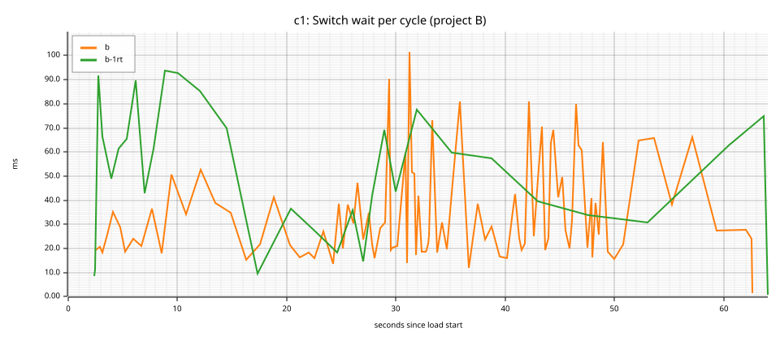

*Shows:* Time the consumer's switch (UPDATE of the controller rows) waited for in-flight inserts, per cycle (project B only, repetition 1). *Purpose:* Cost of the pessimistic lock: producers arriving during a switch wait about as long (risk of failed inserts with a short lock or statement timeout).

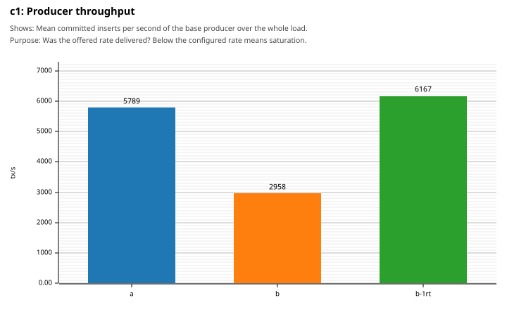

*Shows:* Mean committed inserts per second of the base producer over the whole load. *Purpose:* Was the offered rate delivered? Below the configured rate means saturation.

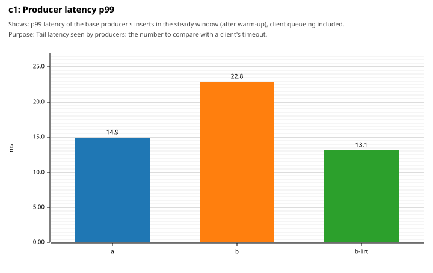

*Shows:* p99 latency of the base producer's inserts in the steady window (after warm-up), client queueing included. *Purpose:* Tail latency seen by producers: the number to compare with a client's timeout.

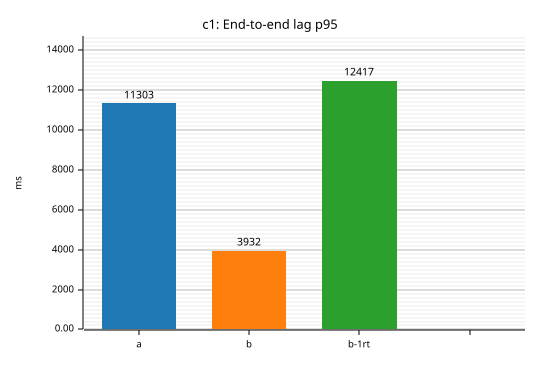

*Shows:* p95 age of the events when applied to orders (steady window, weighted by rows). *Purpose:* Freshness: the price of B's cycle against A's continuous workers.

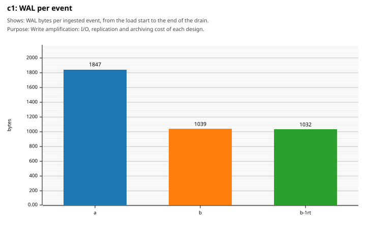

*Shows:* WAL bytes per ingested event, from the load start to the end of the drain. *Purpose:* Write amplification: I/O, replication and archiving cost of each design.

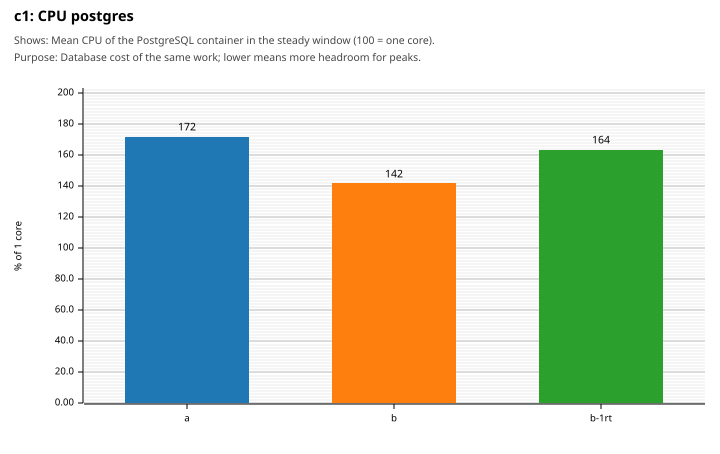

*Shows:* Mean CPU of the PostgreSQL container in the steady window (100 = one core). *Purpose:* Database cost of the same work; lower means more headroom for peaks.

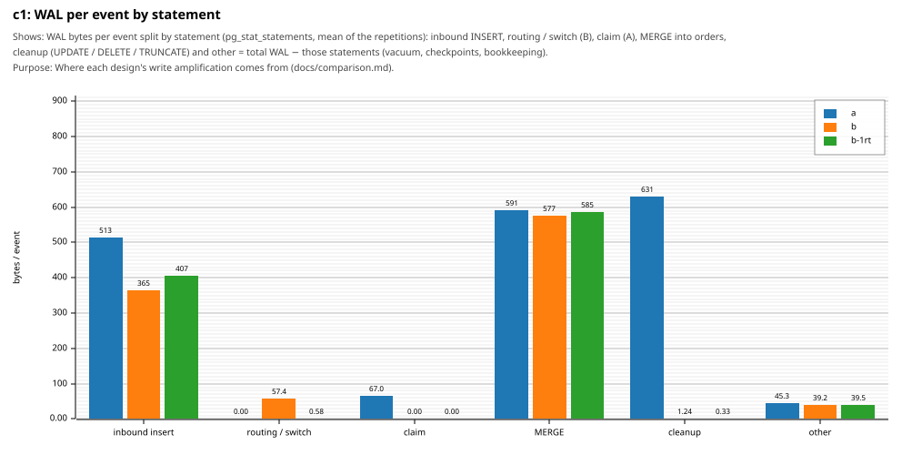

*Shows:* WAL bytes per event split by statement (pg_stat_statements, mean of the repetitions): inbound INSERT, routing / switch (B), claim (A), MERGE into orders, cleanup (UPDATE / DELETE / TRUNCATE) and other = total WAL − those statements (vacuum, checkpoints, bookkeeping). *Purpose:* Where each design's write amplification comes from (docs/comparison.md).

## c2

C2 — sustained load: 16 producers at 2000 tx/s in total (≈64% of B's and ≈34% of A's saturation throughput in the pilot) plus business readers at 200 tx/s on orders. Labels: a (CLEANUP_MODE=update), a-delete (CLEANUP_MODE=delete), b (LOCK_SLOTS=64, one controller row per producer), b-slots1 (C4: LOCK_SLOTS=1, every producer shares one controller row).

Runs — a: 1 rep., a-delete: 1 rep., b: 1 rep., b-slots1: 1 rep.

| Metric | a | a-delete | b | b-slots1 |
|---|---:|---:|---:|---:|
| Producer throughput (tx/s) | 1801 | 1808 | 1799 | 1801 |
| Producer latency p50 (ms) | 1.14 | 1.12 | 2.81 | 2.69 |
| Producer latency p95 (ms) | 5.87 | 6.63 | 19.92 | 19.47 |
| Producer latency p99 (ms) | 16.96 | 17.28 | 39.77 | 46.81 |
| Producer latency p99.9 (ms) | 32.67 | 35.45 | 79.42 | 76.93 |
| Producer latency max (ms) | 55.1 | 44.5 | 100.5 | 126.8 |
| Reader latency p50 (ms) | 0.51 | 0.49 | 0.54 | 0.53 |
| Reader latency p95 (ms) | 3.34 | 3.28 | 4.65 | 4.24 |
| Reader latency p99 (ms) | 9.26 | 9.54 | 13.05 | 12.36 |
| End-to-end lag p50 (ms) | 8 | 7 | 34 | 33 |
| End-to-end lag p95 (ms) | 33 | 34 | 188 | 312 |
| End-to-end lag max (ms) | 120 | 132 | 421 | 573 |
| Backlog max (events) | 0 | 0 | 0 | 0 |
| Drain time after load (s) | 0.2 | 0.2 | 0.2 | 0.2 |
| Batches / cycles | 14348 | 14683 | 1864 | 1734 |
| Rows per batch / cycle | 8 | 7 | 58 | 62 |
| MERGE time per batch avg (ms) | 2.8 | 2.8 | 9.2 | 9.8 |
| Switch wait p50 (ms) | – | – | 2.9 | 2.6 |
| Switch wait p95 (ms) | – | – | 19.8 | 23.5 |
| Switch wait max (ms) | – | – | 159.5 | 421.3 |
| Consumer retries | 0 | 0 | 0 | 0 |
| Inbound table(s) size at end (MB) | 52.4 | 4.4 | 0.0 | 0.0 |
| Inbound table(s) size max (MB) | 52.4 | 4.4 | 1.7 | 1.7 |
| Inbound dead tuples max | 55184 | 56761 | 0 | 0 |
| orders size growth (MB) | 35.0 | 35.0 | 35.3 | 35.6 |
| orders dead tuples max | 27639 | 28086 | 27521 | 27743 |
| Autovacuum runs (all tables) | 3 | 3 | 2 | 2 |
| Autovacuum time (s, all tables) | 0.3 | 0.2 | 0.2 | 0.2 |
| WAL generated (MB) | 159 | 132 | 147 | 142 |
| WAL per event (bytes) | 1544 | 1279 | 1435 | 1386 |
| Deadlocks | 0 | 0 | 0 | 0 |
| Rollbacks | 0 | 0 | 0 | 0 |
| MultiXact SLRU blocks zeroed | 14 | 13 | 0 | 414 |
| CPU postgres (% of 1 core) | 128 | 126 | 132 | 128 |
| CPU consumer (% of 1 core) | 17 | 18 | 3 | 3 |
| CPU pgbench (% of 1 core) | 19 | 19 | 44 | 45 |

Top wait events (avg active sessions, repetition 1):

- **a**: LWLock:WALWrite 1.92, CPU:running 1.16, IO:WalSync 0.60, Client:ClientRead 0.22, LWLock:BufferContent 0.03
- **a-delete**: LWLock:WALWrite 1.80, CPU:running 1.03, IO:WalSync 0.54, Client:ClientRead 0.17, LWLock:BufferContent 0.05
- **b**: LWLock:WALWrite 2.30, CPU:running 1.23, IO:WalSync 0.57, Lock:transactionid 0.56, Client:ClientRead 0.15
- **b-slots1**: LWLock:WALWrite 2.25, CPU:running 1.14, IO:WalSync 0.58, Lock:transactionid 0.25, Client:ClientRead 0.17

Charts (each one states under its title what it shows and what it is for):

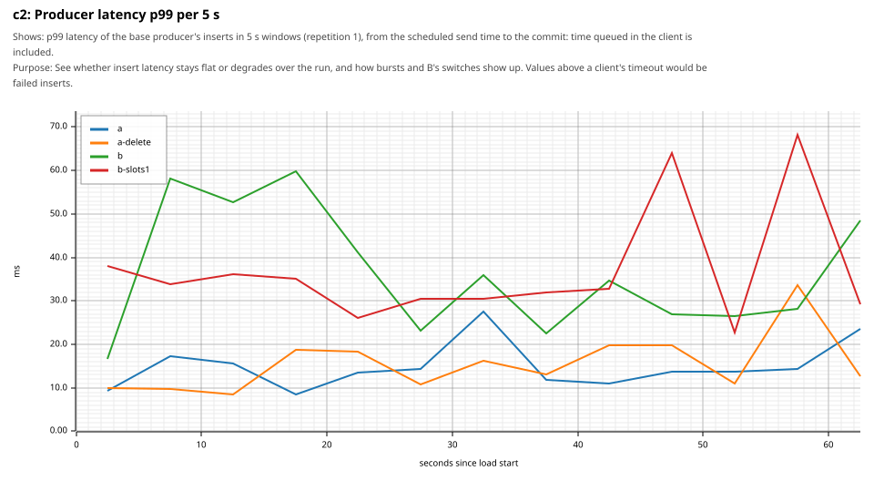

*Shows:* p99 latency of the base producer's inserts in 5 s windows (repetition 1), from the scheduled send time to the commit: time queued in the client is included. *Purpose:* See whether insert latency stays flat or degrades over the run, and how bursts and B's switches show up. Values above a client's timeout would be failed inserts.

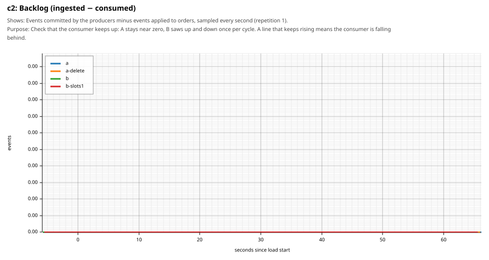

*Shows:* Events committed by the producers minus events applied to orders, sampled every second (repetition 1). *Purpose:* Check that the consumer keeps up: A stays near zero, B saws up and down once per cycle. A line that keeps rising means the consumer is falling behind.

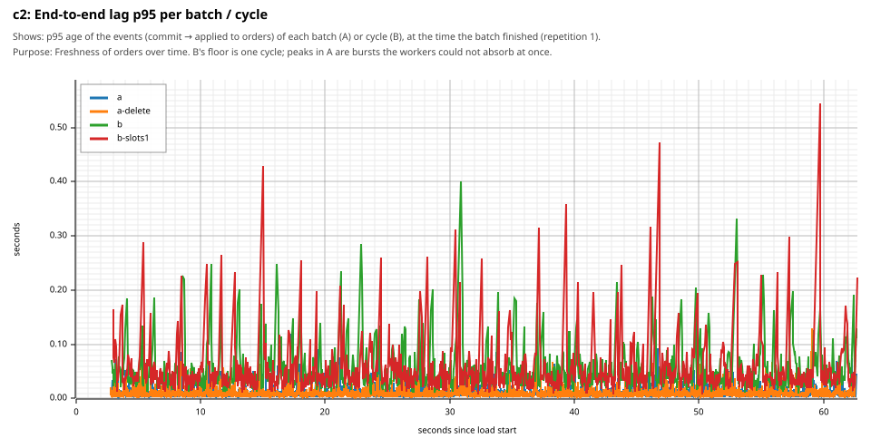

*Shows:* p95 age of the events (commit → applied to orders) of each batch (A) or cycle (B), at the time the batch finished (repetition 1). *Purpose:* Freshness of orders over time. B's floor is one cycle; peaks in A are bursts the workers could not absorb at once.

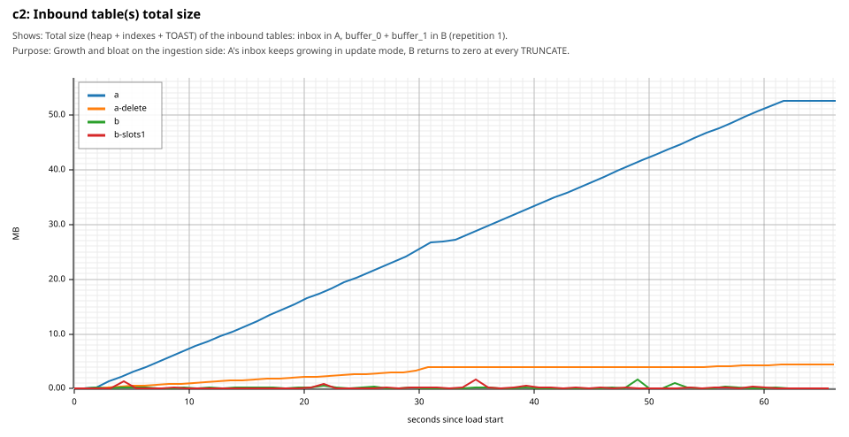

*Shows:* Total size (heap + indexes + TOAST) of the inbound tables: inbox in A, buffer_0 + buffer_1 in B (repetition 1). *Purpose:* Growth and bloat on the ingestion side: A's inbox keeps growing in update mode, B returns to zero at every TRUNCATE.

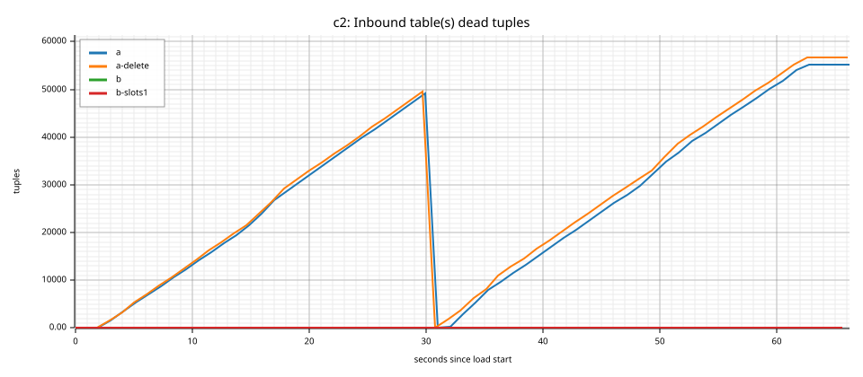

*Shows:* Dead tuples in the inbound tables (repetition 1). *Purpose:* Vacuum debt created by A's UPDATE / DELETE cleanup; B's buffers never hold dead tuples.

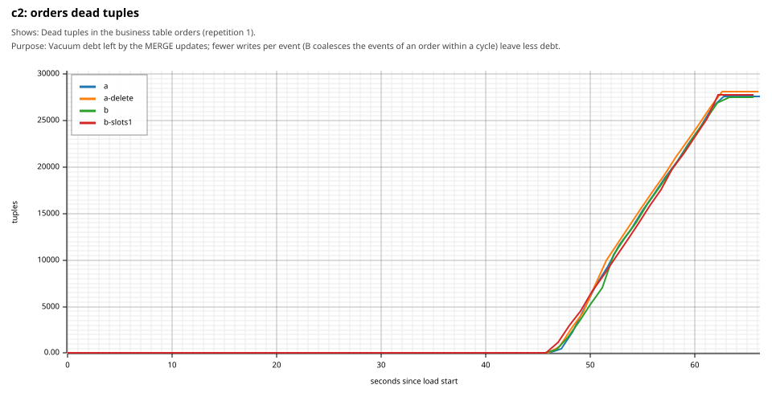

*Shows:* Dead tuples in the business table orders (repetition 1). *Purpose:* Vacuum debt left by the MERGE updates; fewer writes per event (B coalesces the events of an order within a cycle) leave less debt.

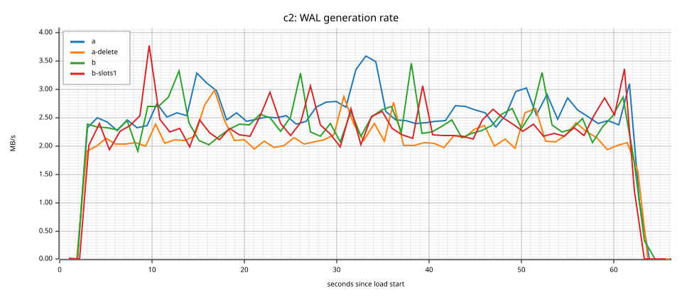

*Shows:* WAL written per second (repetition 1). *Purpose:* Write amplification over time; peaks are checkpoints (full-page writes) and, in B, the large MERGE of each cycle.

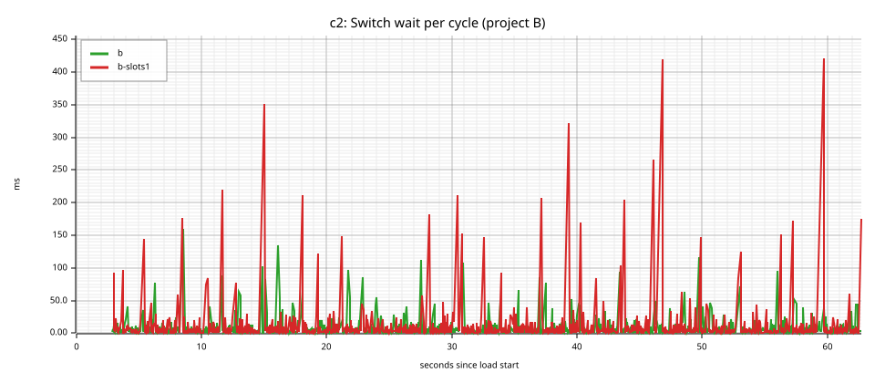

*Shows:* Time the consumer's switch (UPDATE of the controller rows) waited for in-flight inserts, per cycle (project B only, repetition 1). *Purpose:* Cost of the pessimistic lock: producers arriving during a switch wait about as long (risk of failed inserts with a short lock or statement timeout).

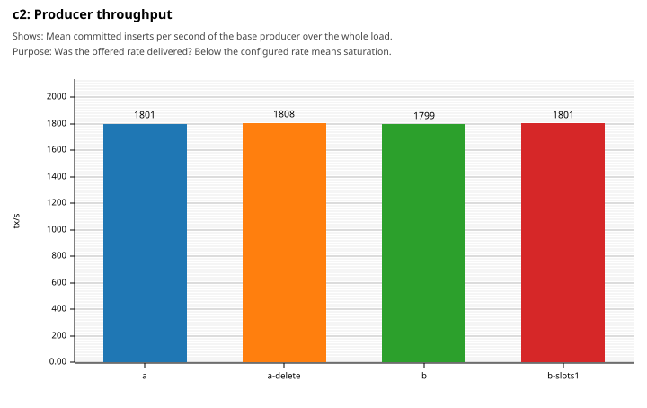

*Shows:* Mean committed inserts per second of the base producer over the whole load. *Purpose:* Was the offered rate delivered? Below the configured rate means saturation.

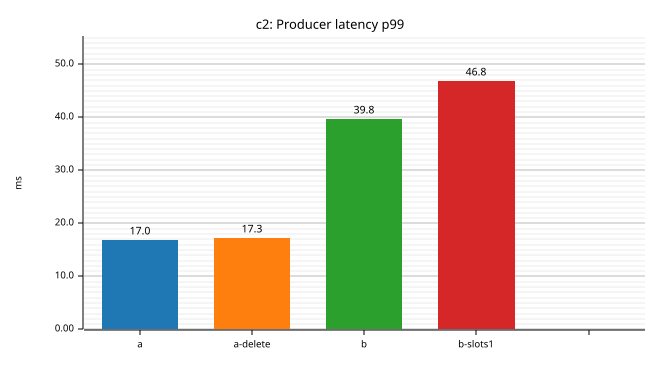

*Shows:* p99 latency of the base producer's inserts in the steady window (after warm-up), client queueing included. *Purpose:* Tail latency seen by producers: the number to compare with a client's timeout.

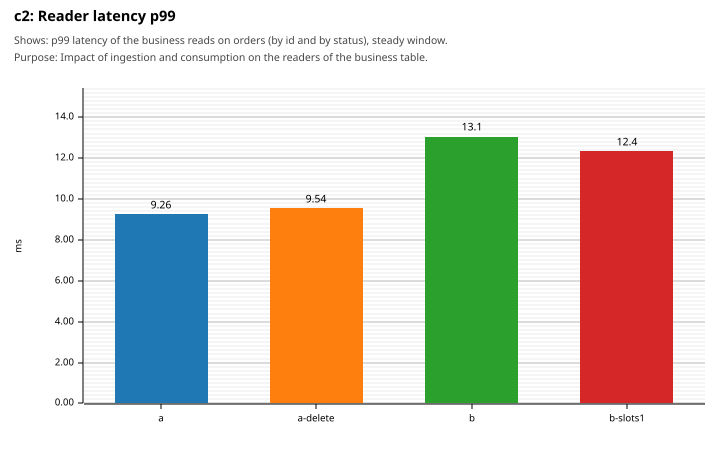

*Shows:* p99 latency of the business reads on orders (by id and by status), steady window. *Purpose:* Impact of ingestion and consumption on the readers of the business table.

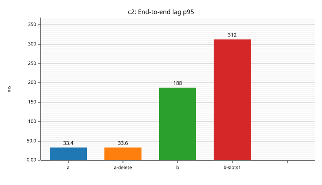

*Shows:* p95 age of the events when applied to orders (steady window, weighted by rows). *Purpose:* Freshness: the price of B's cycle against A's continuous workers.

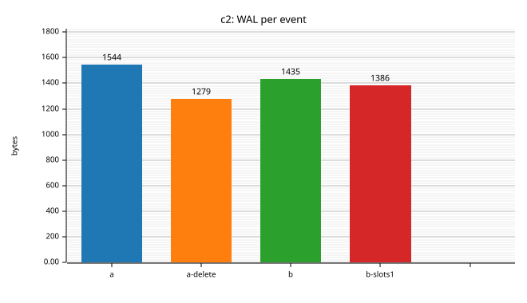

*Shows:* WAL bytes per ingested event, from the load start to the end of the drain. *Purpose:* Write amplification: I/O, replication and archiving cost of each design.

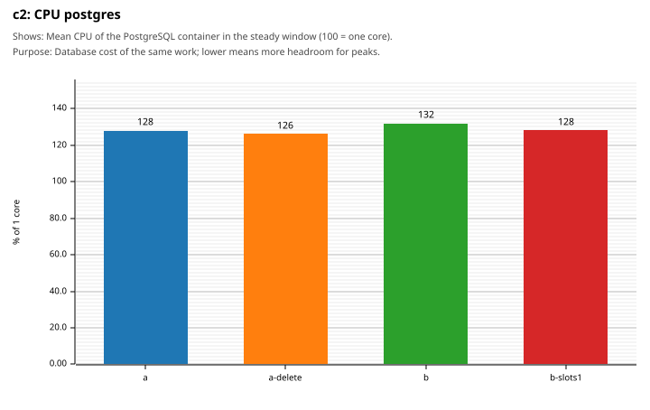

*Shows:* Mean CPU of the PostgreSQL container in the steady window (100 = one core). *Purpose:* Database cost of the same work; lower means more headroom for peaks.

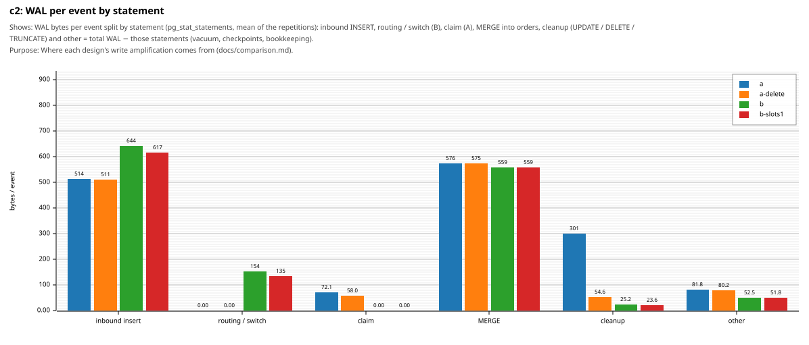

*Shows:* WAL bytes per event split by statement (pg_stat_statements, mean of the repetitions): inbound INSERT, routing / switch (B), claim (A), MERGE into orders, cleanup (UPDATE / DELETE / TRUNCATE) and other = total WAL − those statements (vacuum, checkpoints, bookkeeping). *Purpose:* Where each design's write amplification comes from (docs/comparison.md).

## c3

C3 — burst: C2 load (2000 tx/s + readers) and, from t=120 s to t=180 s, a second producer group (16 clients, distinct order ids and controller slots) adding 4000 tx/s (3× the base rate). Measures backlog build-up and recovery.

Runs — a: 1 rep., b: 1 rep.

| Metric | a | b |
|---|---:|---:|
| Producer throughput (tx/s) | 1796 | 1797 |
| Producer latency p50 (ms) | 1.86 | 147.84 |
| Producer latency p95 (ms) | 20.86 | 3108.86 |
| Producer latency p99 (ms) | 50.46 | 3508.22 |
| Producer latency p99.9 (ms) | 78.72 | 3549.18 |
| Producer latency max (ms) | 97.2 | 3569.7 |
| Burst producer throughput (tx/s) | 3590 | 1479 |
| Reader latency p50 (ms) | 0.64 | 0.82 |
| Reader latency p95 (ms) | 10.62 | 13.23 |
| Reader latency p99 (ms) | 17.25 | 19.86 |
| End-to-end lag p50 (ms) | 2292 | 3568 |
| End-to-end lag p95 (ms) | 5921 | 11126 |
| End-to-end lag max (ms) | 6341 | 11476 |
| Backlog max (events) | 32395 | 31508 |
| Drain time after load (s) | 0.3 | 0.2 |
| Batches / cycles | 7971 | 987 |
| Rows per batch / cycle | 22 | 138 |
| MERGE time per batch avg (ms) | 7.8 | 34.8 |
| Switch wait p50 (ms) | – | 2.7 |
| Switch wait p95 (ms) | – | 26.9 |
| Switch wait max (ms) | – | 134.4 |
| Consumer retries | 0 | 0 |
| Inbound table(s) size at end (MB) | 108.6 | 0.0 |
| Inbound table(s) size max (MB) | 108.6 | 12.5 |
| Inbound dead tuples max | 94505 | 0 |
| orders size growth (MB) | 63.1 | 46.8 |
| orders dead tuples max | 27367 | 27463 |
| Autovacuum runs (all tables) | 3 | 3 |
| Autovacuum time (s, all tables) | 2.3 | 0.5 |
| WAL generated (MB) | 289 | 152 |
| WAL per event (bytes) | 1702 | 1174 |
| Deadlocks | 0 | 0 |
| Rollbacks | 0 | 0 |
| MultiXact SLRU blocks zeroed | 7 | 0 |
| CPU postgres (% of 1 core) | 157 | 145 |
| CPU consumer (% of 1 core) | 9 | 1 |
| CPU pgbench (% of 1 core) | 30 | 55 |

Top wait events (avg active sessions, repetition 1):

- **a**: LWLock:WALWrite 7.09, CPU:running 2.68, LWLock:BufferContent 0.70, IO:WalSync 0.63, LWLock:WALInsert 0.43
- **b**: LWLock:WALWrite 5.56, CPU:running 2.19, IO:WalSync 0.64, Lock:transactionid 0.61, Client:ClientRead 0.26

Charts (each one states under its title what it shows and what it is for):

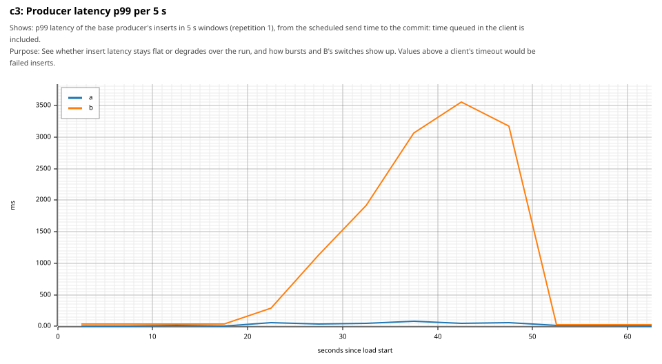

*Shows:* p99 latency of the base producer's inserts in 5 s windows (repetition 1), from the scheduled send time to the commit: time queued in the client is included. *Purpose:* See whether insert latency stays flat or degrades over the run, and how bursts and B's switches show up. Values above a client's timeout would be failed inserts.

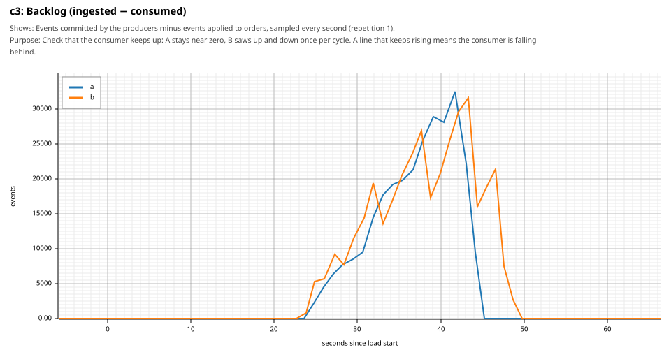

*Shows:* Events committed by the producers minus events applied to orders, sampled every second (repetition 1). *Purpose:* Check that the consumer keeps up: A stays near zero, B saws up and down once per cycle. A line that keeps rising means the consumer is falling behind.

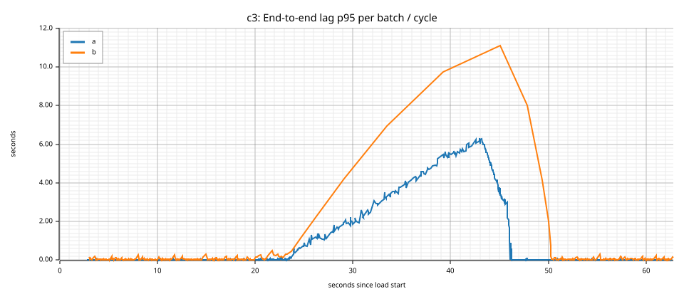

*Shows:* p95 age of the events (commit → applied to orders) of each batch (A) or cycle (B), at the time the batch finished (repetition 1). *Purpose:* Freshness of orders over time. B's floor is one cycle; peaks in A are bursts the workers could not absorb at once.

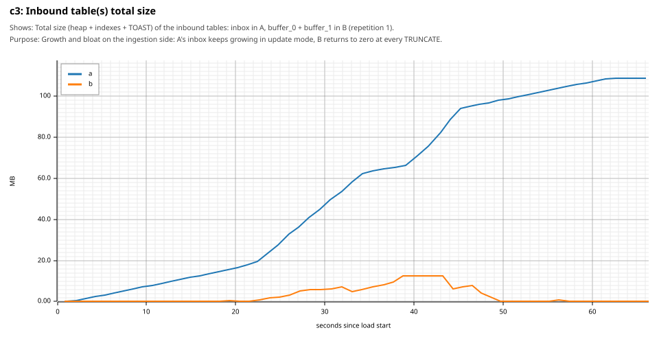

*Shows:* Total size (heap + indexes + TOAST) of the inbound tables: inbox in A, buffer_0 + buffer_1 in B (repetition 1). *Purpose:* Growth and bloat on the ingestion side: A's inbox keeps growing in update mode, B returns to zero at every TRUNCATE.

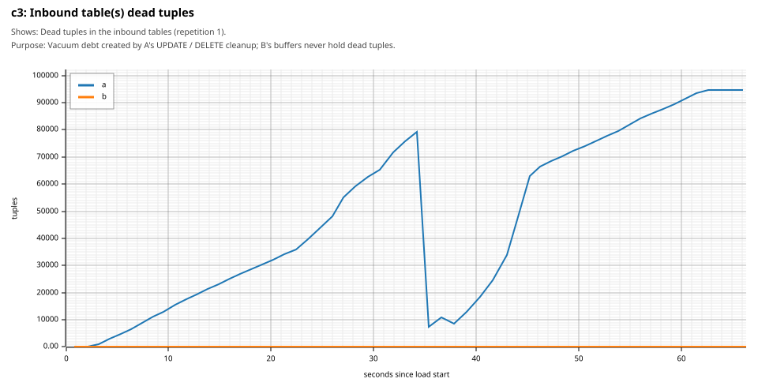

*Shows:* Dead tuples in the inbound tables (repetition 1). *Purpose:* Vacuum debt created by A's UPDATE / DELETE cleanup; B's buffers never hold dead tuples.

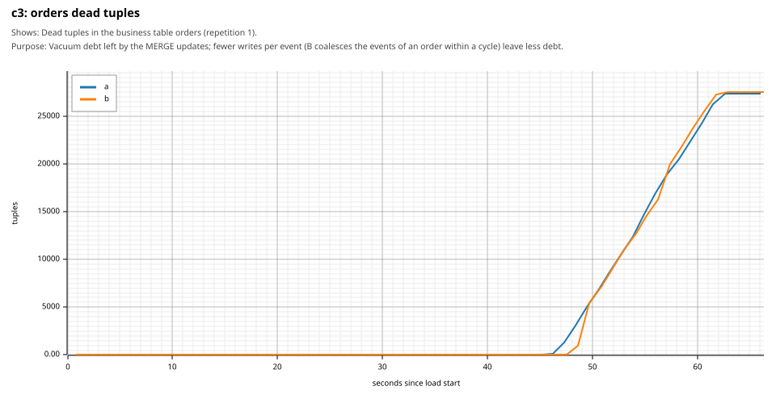

*Shows:* Dead tuples in the business table orders (repetition 1). *Purpose:* Vacuum debt left by the MERGE updates; fewer writes per event (B coalesces the events of an order within a cycle) leave less debt.

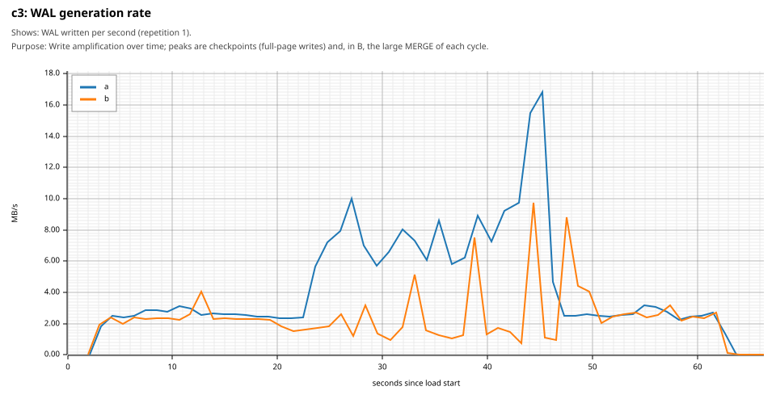

*Shows:* WAL written per second (repetition 1). *Purpose:* Write amplification over time; peaks are checkpoints (full-page writes) and, in B, the large MERGE of each cycle.

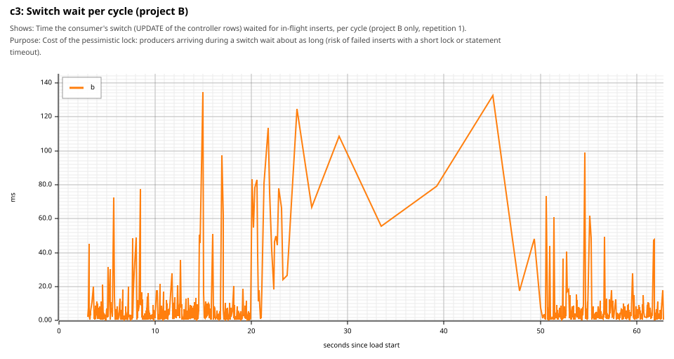

*Shows:* Time the consumer's switch (UPDATE of the controller rows) waited for in-flight inserts, per cycle (project B only, repetition 1). *Purpose:* Cost of the pessimistic lock: producers arriving during a switch wait about as long (risk of failed inserts with a short lock or statement timeout).

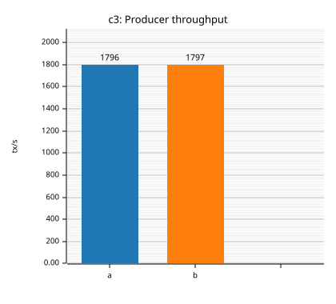

*Shows:* Mean committed inserts per second of the base producer over the whole load. *Purpose:* Was the offered rate delivered? Below the configured rate means saturation.

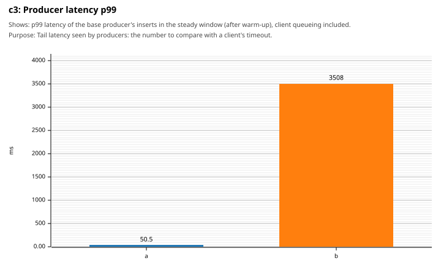

*Shows:* p99 latency of the base producer's inserts in the steady window (after warm-up), client queueing included. *Purpose:* Tail latency seen by producers: the number to compare with a client's timeout.

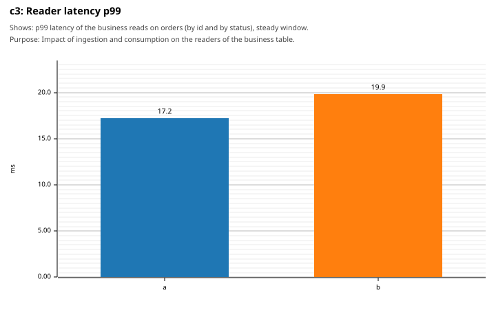

*Shows:* p99 latency of the business reads on orders (by id and by status), steady window. *Purpose:* Impact of ingestion and consumption on the readers of the business table.

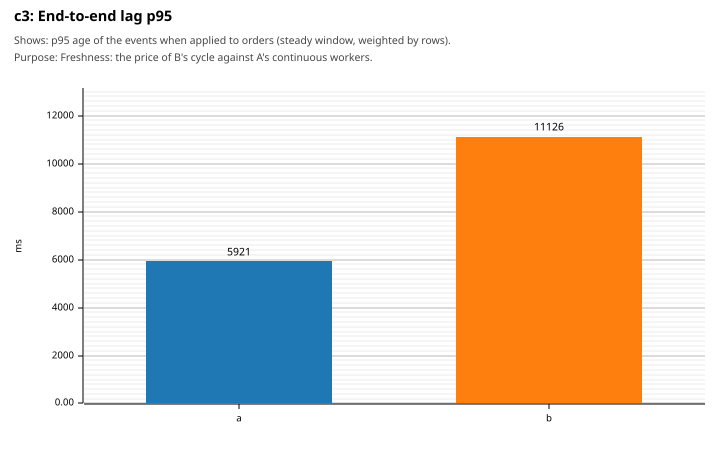

*Shows:* p95 age of the events when applied to orders (steady window, weighted by rows). *Purpose:* Freshness: the price of B's cycle against A's continuous workers.

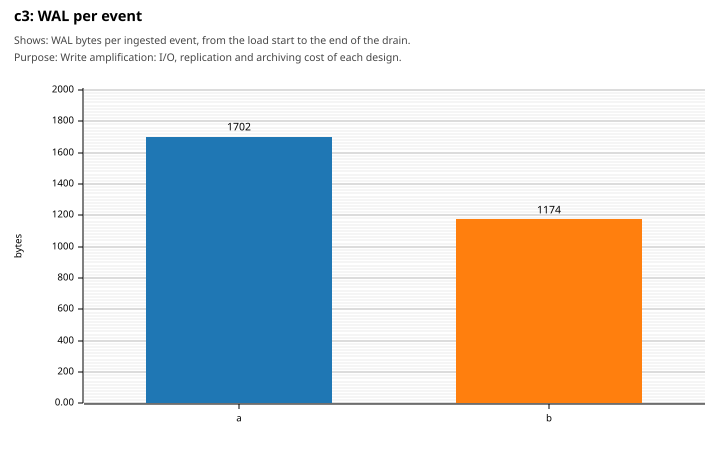

*Shows:* WAL bytes per ingested event, from the load start to the end of the drain. *Purpose:* Write amplification: I/O, replication and archiving cost of each design.

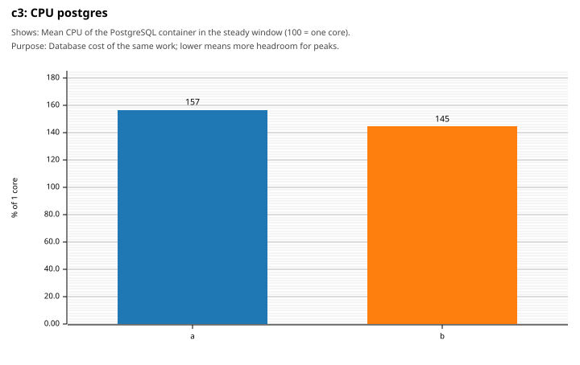

*Shows:* Mean CPU of the PostgreSQL container in the steady window (100 = one core). *Purpose:* Database cost of the same work; lower means more headroom for peaks.

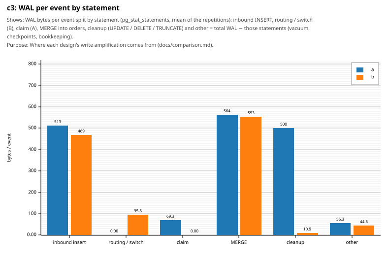

*Shows:* WAL bytes per event split by statement (pg_stat_statements, mean of the repetitions): inbound INSERT, routing / switch (B), claim (A), MERGE into orders, cleanup (UPDATE / DELETE / TRUNCATE) and other = total WAL − those statements (vacuum, checkpoints, bookkeeping). *Purpose:* Where each design's write amplification comes from (docs/comparison.md).

## c5

C5 — massive concurrency: PRODUCER_CLIENTS concurrent producer connections in closed loop (each client sends its next event as soon as the previous one commits), spread over PRODUCER_REPLICAS pgbench containers and multiplexed by PgBouncer (transaction pooling, PGBOUNCER_PROCESSES × PGBOUNCER_POOL_SIZE server connections), plus business readers. Millions of events per run; producer latency includes the wait for a pooled server connection. Labels: a; b (LOCK_SLOTS=1024, 16 slots per server connection; BEGIN / FOR SHARE / INSERT / COMMIT holds a pooled connection for 4 round trips); b-1rt (single-statement routing, producer-1rt.sql: 1 round trip); b-slots64 (64 slots: several pooled connections per controller row).

Runs — a: 1 rep., b: 1 rep., b-1rt: 1 rep., b-slots64: 1 rep.

| Metric | a | b | b-1rt | b-slots64 |
|---|---:|---:|---:|---:|
| Producer throughput (tx/s) | 2144 | 852 | 849 | 922 |
| Producer latency p50 (ms) | 930.82 | 2369.53 | 2828.29 | 2185.22 |
| Producer latency p95 (ms) | 1160.19 | 2656.26 | 3356.67 | 2416.64 |
| Producer latency p99 (ms) | 1240.06 | 2697.22 | 3452.93 | 2539.52 |
| Producer latency p99.9 (ms) | 1339.39 | 2740.22 | 3479.55 | 2562.05 |
| Producer latency max (ms) | 1374.2 | 2740.2 | 3479.6 | 2562.0 |
| Reader latency p50 (ms) | 1.40 | 1.33 | 1.38 | 1.25 |
| Reader latency p95 (ms) | 13.06 | 12.62 | 12.78 | 12.63 |
| Reader latency p99 (ms) | 17.63 | 17.44 | 17.70 | 17.36 |
| End-to-end lag p50 (ms) | 444 | 397 | 389 | 397 |
| End-to-end lag p95 (ms) | 1163 | 1185 | 1028 | 1459 |
| End-to-end lag max (ms) | 1638 | 1585 | 1341 | 1890 |
| Backlog max (events) | 2095 | 522 | 729 | 1279 |
| Drain time after load (s) | 0.2 | 0.2 | 0.2 | 0.2 |
| Batches / cycles | 899 | 185 | 190 | 189 |
| Rows per batch / cycle | 143 | 281 | 272 | 297 |
| MERGE time per batch avg (ms) | 109.9 | 157.2 | 148.9 | 166.2 |
| Switch wait p50 (ms) | – | 58.7 | 45.8 | 54.6 |
| Switch wait p95 (ms) | – | 125.0 | 101.4 | 114.2 |
| Switch wait max (ms) | – | 183.7 | 208.5 | 167.1 |
| Consumer retries | 0 | 0 | 0 | 0 |
| Inbound table(s) size at end (MB) | 83.5 | 0.0 | 0.0 | 0.0 |
| Inbound table(s) size max (MB) | 83.5 | 2.1 | 2.2 | 2.2 |
| Inbound dead tuples max | 62831 | 0 | 0 | 0 |
| orders size growth (MB) | 40.2 | 19.2 | 17.6 | 20.8 |
| orders dead tuples max | 71655 | 11959 | 11723 | 16094 |
| Autovacuum runs (all tables) | 2 | 1 | 2 | 2 |
| Autovacuum time (s, all tables) | 2.2 | 0.0 | 0.1 | 0.2 |
| WAL generated (MB) | 221 | 58 | 58 | 59 |
| WAL per event (bytes) | 1806 | 1179 | 1175 | 1108 |
| Deadlocks | 0 | 0 | 0 | 0 |
| Rollbacks | 0 | 0 | 0 | 0 |
| MultiXact SLRU blocks zeroed | 2 | 2 | 2 | 12 |
| CPU postgres (% of 1 core) | 104 | 78 | 86 | 83 |
| CPU consumer (% of 1 core) | 2 | 0 | 0 | 0 |
| CPU pgbench (% of 1 core) | 84 | 91 | 96 | 95 |

Top wait events (avg active sessions, repetition 1):

- **a**: LWLock:WALWrite 9.53, CPU:running 4.10, LWLock:BufferContent 0.83, IO:WalSync 0.77, LWLock:LockManager 0.24
- **b**: LWLock:WALWrite 3.53, CPU:running 2.49, Lock:transactionid 1.19, IO:WalSync 0.65, Client:ClientRead 0.15
- **b-1rt**: LWLock:WALWrite 4.12, CPU:running 3.49, Lock:transactionid 0.90, IO:WalSync 0.65, Lock:relation 0.11
- **b-slots64**: LWLock:WALWrite 3.68, CPU:running 2.47, Lock:transactionid 1.03, IO:WalSync 0.63, Lock:extend 0.12

Charts (each one states under its title what it shows and what it is for):

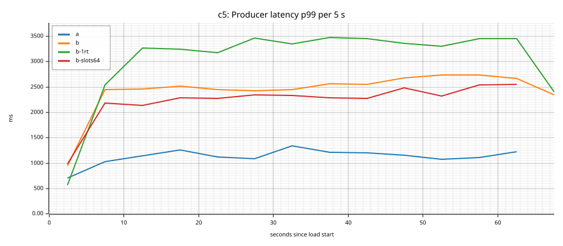

*Shows:* p99 latency of the base producer's inserts in 5 s windows (repetition 1), from the scheduled send time to the commit: time queued in the client is included. *Purpose:* See whether insert latency stays flat or degrades over the run, and how bursts and B's switches show up. Values above a client's timeout would be failed inserts.

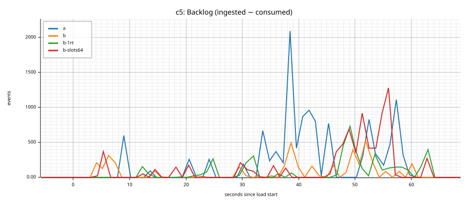

*Shows:* Events committed by the producers minus events applied to orders, sampled every second (repetition 1). *Purpose:* Check that the consumer keeps up: A stays near zero, B saws up and down once per cycle. A line that keeps rising means the consumer is falling behind.

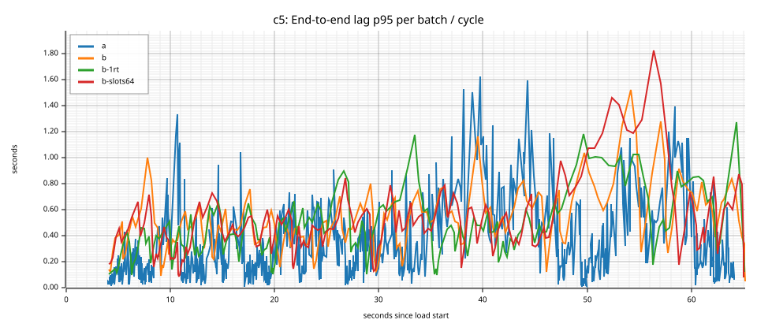

*Shows:* p95 age of the events (commit → applied to orders) of each batch (A) or cycle (B), at the time the batch finished (repetition 1). *Purpose:* Freshness of orders over time. B's floor is one cycle; peaks in A are bursts the workers could not absorb at once.

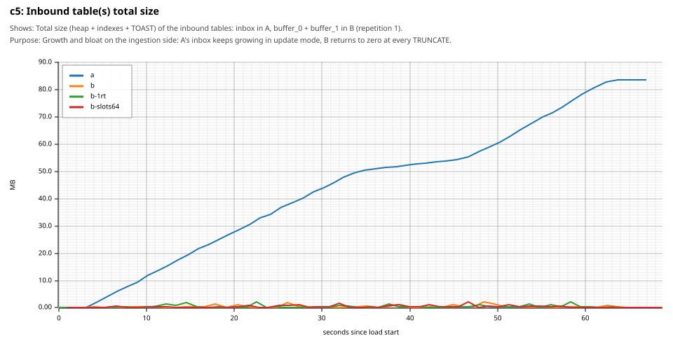

*Shows:* Total size (heap + indexes + TOAST) of the inbound tables: inbox in A, buffer_0 + buffer_1 in B (repetition 1). *Purpose:* Growth and bloat on the ingestion side: A's inbox keeps growing in update mode, B returns to zero at every TRUNCATE.

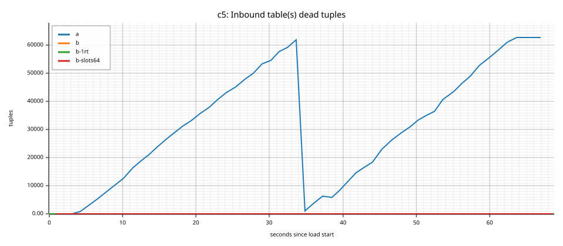

*Shows:* Dead tuples in the inbound tables (repetition 1). *Purpose:* Vacuum debt created by A's UPDATE / DELETE cleanup; B's buffers never hold dead tuples.

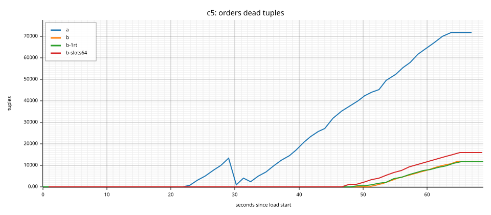

*Shows:* Dead tuples in the business table orders (repetition 1). *Purpose:* Vacuum debt left by the MERGE updates; fewer writes per event (B coalesces the events of an order within a cycle) leave less debt.

*Shows:* WAL written per second (repetition 1). *Purpose:* Write amplification over time; peaks are checkpoints (full-page writes) and, in B, the large MERGE of each cycle.

*Shows:* Time the consumer's switch (UPDATE of the controller rows) waited for in-flight inserts, per cycle (project B only, repetition 1). *Purpose:* Cost of the pessimistic lock: producers arriving during a switch wait about as long (risk of failed inserts with a short lock or statement timeout).

*Shows:* Mean committed inserts per second of the base producer over the whole load. *Purpose:* Was the offered rate delivered? Below the configured rate means saturation.

*Shows:* p99 latency of the base producer's inserts in the steady window (after warm-up), client queueing included. *Purpose:* Tail latency seen by producers: the number to compare with a client's timeout.

*Shows:* p99 latency of the business reads on orders (by id and by status), steady window. *Purpose:* Impact of ingestion and consumption on the readers of the business table.

*Shows:* p95 age of the events when applied to orders (steady window, weighted by rows). *Purpose:* Freshness: the price of B's cycle against A's continuous workers.

*Shows:* WAL bytes per ingested event, from the load start to the end of the drain. *Purpose:* Write amplification: I/O, replication and archiving cost of each design.

*Shows:* Mean CPU of the PostgreSQL container in the steady window (100 = one core). *Purpose:* Database cost of the same work; lower means more headroom for peaks.

*Shows:* WAL bytes per event split by statement (pg_stat_statements, mean of the repetitions): inbound INSERT, routing / switch (B), claim (A), MERGE into orders, cleanup (UPDATE / DELETE / TRUNCATE) and other = total WAL − those statements (vacuum, checkpoints, bookkeeping). *Purpose:* Where each design's write amplification comes from (docs/comparison.md).

## pilot

Runs — a: 1 rep., b: 1 rep.

| Metric | a | b |
|---|---:|---:|
| Producer throughput (tx/s) | 5677 | 3022 |
| Producer latency p50 (ms) | 2.00 | 4.38 |
| Producer latency p95 (ms) | 7.37 | 10.81 |
| Producer latency p99 (ms) | 15.72 | 22.35 |
| Producer latency p99.9 (ms) | 50.24 | 43.33 |
| Producer latency max (ms) | 76.3 | 81.9 |
| End-to-end lag p50 (ms) | 5812 | 2293 |
| End-to-end lag p95 (ms) | 9256 | 4466 |
| End-to-end lag max (ms) | 9909 | 4855 |
| Backlog max (events) | 51457 | 12101 |
| Drain time after load (s) | 3.6 | 0.2 |
| Batches / cycles | 703 | 79 |
| Rows per batch / cycle | 483 | 2290 |
| MERGE time per batch avg (ms) | 167.6 | 648.8 |
| Switch wait p50 (ms) | – | 26.1 |
| Switch wait p95 (ms) | – | 81.2 |
| Switch wait max (ms) | – | 142.1 |
| Consumer retries | 0 | 0 |
| Inbound table(s) size at end (MB) | 229.8 | 0.0 |
| Inbound table(s) size max (MB) | 229.8 | 4.2 |
| Inbound dead tuples max | 192677 | 0 |
| orders size growth (MB) | 101.6 | 67.1 |
| orders dead tuples max | 190399 | 99793 |
| Autovacuum runs (all tables) | 2 | 3 |
| Autovacuum time (s, all tables) | 2.8 | 1.1 |
| WAL generated (MB) | 598 | 179 |
| WAL per event (bytes) | 1846 | 1036 |
| Deadlocks | 0 | 0 |
| Rollbacks | 0 | 0 |
| MultiXact SLRU blocks zeroed | 2 | 0 |
| CPU postgres (% of 1 core) | 160 | 137 |
| CPU consumer (% of 1 core) | 1 | 0 |
| CPU pgbench (% of 1 core) | 31 | 55 |

Top wait events (avg active sessions, repetition 1):

- **a**: LWLock:WALWrite 10.71, CPU:running 4.14, IO:WalSync 0.75, LWLock:BufferContent 0.59, LWLock:WALInsert 0.50
- **b**: LWLock:WALWrite 4.75, CPU:running 2.27, IO:WalSync 0.60, LWLock:BufferContent 0.28, Lock:transactionid 0.13

Charts (each one states under its title what it shows and what it is for):

*Shows:* p99 latency of the base producer's inserts in 5 s windows (repetition 1), from the scheduled send time to the commit: time queued in the client is included. *Purpose:* See whether insert latency stays flat or degrades over the run, and how bursts and B's switches show up. Values above a client's timeout would be failed inserts.

*Shows:* Events committed by the producers minus events applied to orders, sampled every second (repetition 1). *Purpose:* Check that the consumer keeps up: A stays near zero, B saws up and down once per cycle. A line that keeps rising means the consumer is falling behind.

*Shows:* p95 age of the events (commit → applied to orders) of each batch (A) or cycle (B), at the time the batch finished (repetition 1). *Purpose:* Freshness of orders over time. B's floor is one cycle; peaks in A are bursts the workers could not absorb at once.

*Shows:* Total size (heap + indexes + TOAST) of the inbound tables: inbox in A, buffer_0 + buffer_1 in B (repetition 1). *Purpose:* Growth and bloat on the ingestion side: A's inbox keeps growing in update mode, B returns to zero at every TRUNCATE.

*Shows:* Dead tuples in the inbound tables (repetition 1). *Purpose:* Vacuum debt created by A's UPDATE / DELETE cleanup; B's buffers never hold dead tuples.

*Shows:* Dead tuples in the business table orders (repetition 1). *Purpose:* Vacuum debt left by the MERGE updates; fewer writes per event (B coalesces the events of an order within a cycle) leave less debt.

*Shows:* WAL written per second (repetition 1). *Purpose:* Write amplification over time; peaks are checkpoints (full-page writes) and, in B, the large MERGE of each cycle.

*Shows:* Time the consumer's switch (UPDATE of the controller rows) waited for in-flight inserts, per cycle (project B only, repetition 1). *Purpose:* Cost of the pessimistic lock: producers arriving during a switch wait about as long (risk of failed inserts with a short lock or statement timeout).

*Shows:* Mean committed inserts per second of the base producer over the whole load. *Purpose:* Was the offered rate delivered? Below the configured rate means saturation.

*Shows:* p99 latency of the base producer's inserts in the steady window (after warm-up), client queueing included. *Purpose:* Tail latency seen by producers: the number to compare with a client's timeout.

*Shows:* p95 age of the events when applied to orders (steady window, weighted by rows). *Purpose:* Freshness: the price of B's cycle against A's continuous workers.

*Shows:* WAL bytes per ingested event, from the load start to the end of the drain. *Purpose:* Write amplification: I/O, replication and archiving cost of each design.

*Shows:* Mean CPU of the PostgreSQL container in the steady window (100 = one core). *Purpose:* Database cost of the same work; lower means more headroom for peaks.

*Shows:* WAL bytes per event split by statement (pg_stat_statements, mean of the repetitions): inbound INSERT, routing / switch (B), claim (A), MERGE into orders, cleanup (UPDATE / DELETE / TRUNCATE) and other = total WAL − those statements (vacuum, checkpoints, bookkeeping). *Purpose:* Where each design's write amplification comes from (docs/comparison.md).

